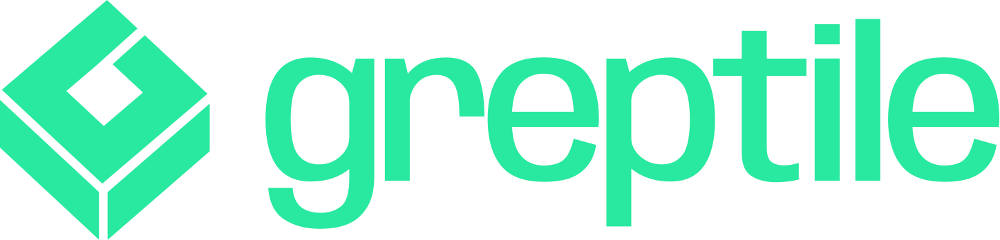
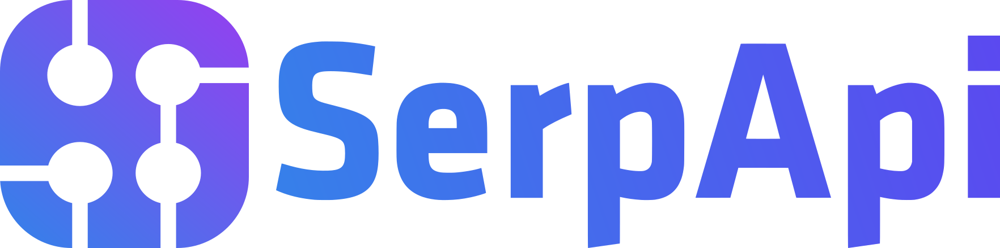
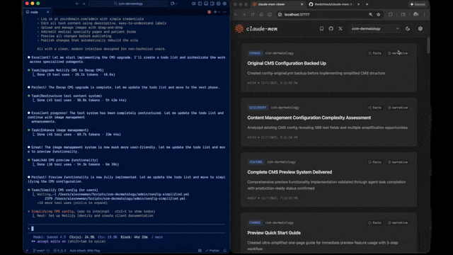

<h1 align="center">
  <br>
  <a href="https://github.com/thedotmack/claude-mem">
    <picture>
      <source media="(prefers-color-scheme: dark)" srcset="docs/public/claude-mem-logo-for-dark-mode.webp">
      <source media="(prefers-color-scheme: light)" srcset="docs/public/claude-mem-logo-for-light-mode.webp">
      
    </picture>
  </a>
</h1>

<p align="center">
  
  &nbsp;&nbsp;&nbsp;
  
  &nbsp;&nbsp;&nbsp;
  
</p>

<p align="center">
  <a href="docs/i18n/README.zh.md">🇨🇳 中文</a> •
  <a href="docs/i18n/README.zh-tw.md">🇹🇼 繁體中文</a> •
  <a href="docs/i18n/README.ja.md">🇯🇵 日本語</a> •
  <a href="docs/i18n/README.pt.md">🇵🇹 Português</a> •
  <a href="docs/i18n/README.pt-br.md">🇧🇷 Português</a> •
  <a href="docs/i18n/README.ko.md">🇰🇷 한국어</a> •
  <a href="docs/i18n/README.es.md">🇪🇸 Español</a> •
  <a href="docs/i18n/README.de.md">🇩🇪 Deutsch</a> •
  <a href="docs/i18n/README.fr.md">🇫🇷 Français</a> •
  <a href="docs/i18n/README.he.md">🇮🇱 עברית</a> •
  <a href="docs/i18n/README.ar.md">🇸🇦 العربية</a> •
  <a href="docs/i18n/README.ru.md">🇷🇺 Русский</a> •
  <a href="docs/i18n/README.pl.md">🇵🇱 Polski</a> •
  <a href="docs/i18n/README.cs.md">🇨🇿 Čeština</a> •
  <a href="docs/i18n/README.nl.md">🇳🇱 Nederlands</a> •
  <a href="docs/i18n/README.tr.md">🇹🇷 Türkçe</a> •
  <a href="docs/i18n/README.uk.md">🇺🇦 Українська</a> •
  <a href="docs/i18n/README.vi.md">🇻🇳 Tiếng Việt</a> •
  <a href="docs/i18n/README.tl.md">🇵🇭 Tagalog</a> •
  <a href="docs/i18n/README.id.md">🇮🇩 Indonesia</a> •
  <a href="docs/i18n/README.th.md">🇹🇭 ไทย</a> •
  <a href="docs/i18n/README.hi.md">🇮🇳 हिन्दी</a> •
  <a href="docs/i18n/README.bn.md">🇧🇩 বাংলা</a> •
  <a href="docs/i18n/README.ur.md">🇵🇰 اردو</a> •
  <a href="docs/i18n/README.ro.md">🇷🇴 Română</a> •
  <a href="docs/i18n/README.sv.md">🇸🇪 Svenska</a> •
  <a href="docs/i18n/README.it.md">🇮🇹 Italiano</a> •
  <a href="docs/i18n/README.el.md">🇬🇷 Ελληνικά</a> •
  <a href="docs/i18n/README.hu.md">🇭🇺 Magyar</a> •
  <a href="docs/i18n/README.fi.md">🇫🇮 Suomi</a> •
  <a href="docs/i18n/README.da.md">🇩🇰 Dansk</a> •
  <a href="docs/i18n/README.no.md">🇳🇴 Norsk</a>
</p>

<h4 align="center">Your coding agent forgets everything between sessions. Claude-Mem remembers for it.</h4>

<p align="center">
  <a href="LICENSE">
    
  </a>
  <a href="package.json">
    
  </a>
  <a href="package.json">
    
  </a>
  <a href="https://github.com/thedotmack/awesome-claude-code">
    
  </a>
</p>

<p align="center">
 <a href="https://www.star-history.com/thedotmack/claude-mem">
  <picture><source media="(prefers-color-scheme: dark)" srcset="https://api.star-history.com/badge?repo=thedotmack/claude-mem&type=rank&theme=dark" /><source media="(prefers-color-scheme: light)" srcset="https://api.star-history.com/badge?repo=thedotmack/claude-mem&type=rank" /></picture> <picture><source media="(prefers-color-scheme: dark)" srcset="https://api.star-history.com/badge?repo=thedotmack/claude-mem&type=trending&theme=dark" /><source media="(prefers-color-scheme: light)" srcset="https://api.star-history.com/badge?repo=thedotmack/claude-mem&type=trending" /></picture>
 </a>
</p>

<br>

<table align="center">
  <tr>
    <td align="center">
      <a href="https://github.com/thedotmack/claude-mem">
        <picture>
          
        </picture>
      </a>
    </td>
    <td align="center">
      <a href="https://www.star-history.com/#thedotmack/claude-mem&Date">
        <picture>
          <source
            media="(prefers-color-scheme: dark)"
            srcset="https://api.star-history.com/image?repos=thedotmack/claude-mem&type=date&theme=dark&legend=top-left"
          />
          <source
            media="(prefers-color-scheme: light)"
            srcset="https://api.star-history.com/image?repos=thedotmack/claude-mem&type=date&legend=top-left"
          />
          
        </picture>
      </a>
    </td>
  </tr>
</table>

<p align="center">
  <a href="#quick-start">Quick Start</a> •
  <a href="#how-it-works">How It Works</a> •
  <a href="#mcp-search-tools">Search Tools</a> •
  <a href="#documentation">Documentation</a> •
  <a href="#configuration">Configuration</a> •
  <a href="#troubleshooting">Troubleshooting</a> •
  <a href="#license">License</a>
</p>

<p align="center">
  Every new session, your agent starts from zero. It re-reads the same files, re-asks the same questions, and walks back into mistakes you already fixed together.
</p>

<p align="center">
  Claude-Mem runs a second agent beside it that takes notes while it works. The next session starts with a short index of what matters, and pulls in the details only when it needs them. Works with Claude Code, Codex, Cursor, OpenCode and 11 more agents. Copilot CLI, Goose, Roo Code and Warp can search your memory, but their sessions aren't recorded.
</p>

---

## Quick Start

**Installing for someone as an AI agent?** Run `npx claude-mem install --runtime worker` on their computer in an interactive terminal (enable PTY in your shell tool). It first asks in the terminal which agents to set up and, for Claude Code, whether to disable native auto-memory (and whether to overwrite an existing install). Relay each question to the user and type their answer, or pass `--ide <id>` to skip the first one. Keep the installer running. When it prints **Continue setup in your browser**, open that URL in the user's browser if the installer hasn't already opened it. Let the user go through setup and make their own choices, including the usage-analytics question the installer may ask at the end. If you can't run an interactive terminal on their computer, give them the command to run locally.

```bash
npx claude-mem install
```

The installer finds the agents on your machine and asks which ones to set up. Then just start working: observations stream in from your first prompt, and your second session in a project opens with memory from the first. (Copilot CLI, Goose, Roo Code and Warp get memory search only, so their sessions don't add to it.)

The installer sets everything up first, then asks you to sign in to claude-mem in your browser (email magic link, no card required to sign in). Choosing the **claude-mem observer** then starts its **30 Day Free Trial** on a checkout page that asks for a payment method; once it completes, the installer saves your memory key. With the observer, memory runs off-plan, so you get up to 100% more usage from your plan. When the free trial ends, memory automatically falls back to your Anthropic plan unless you subscribe. After sign-in you pick your memory provider: the claude-mem observer, your own OpenRouter or Gemini key, or your Anthropic plan.

Prefer to skip the sign-in? Pass an explicit `--provider` flag, set `CLAUDE_MEM_ONLINE_OPTIN=false`, or run in CI/non-interactive shells — the installer completes without any account interaction.

Your memory lives in `~/.claude-mem` on your machine. Cloud sync is opt-in. Anonymous usage analytics are on by default; `npx claude-mem telemetry disable` turns them off ([what's collected](https://docs.claude-mem.ai/telemetry)).

Or install from the plugin marketplace inside Claude Code:

```bash
/plugin marketplace add thedotmack/claude-mem

/plugin install claude-mem
```

Restart Claude Code. Context from previous sessions will automatically appear in new sessions.

> **Note:** Claude-Mem is also published on npm, but `npm install -g claude-mem` installs the **SDK/library only** — it does not register the plugin hooks or set up the worker service. Always install via `npx claude-mem install` or the `/plugin` commands above.

### Other agents

`npx claude-mem install` covers every supported agent. To set up one agent directly, pass `--ide`.

**OpenCode** (1.3.4 or later, including OpenCode 2). Restart OpenCode after installing.

```bash
npx claude-mem install --ide opencode
```

**T3 Code** (Codex and Claude Code providers). The installer discovers T3 Code's enabled providers, registers native Claude-Mem plugins in their configured homes, and supports T3-managed Codex. Restart T3 Code, trust the provider's hooks when prompted, and start a new thread. See the [T3 Code integration guide](https://docs.claude-mem.ai/t3code-integration) for custom server settings, status, and removal.

```bash
npx claude-mem install --ide t3code
```

**Antigravity CLI** ([setup guide](https://docs.claude-mem.ai/antigravity-cli/setup)):

```bash
npx claude-mem install --ide antigravity
```

**OMP (Oh My Pi):**

```bash
npx claude-mem install --ide omp
```

**Pi and DeepSeek Harness** use the worker runtime. See [native harness setup](docs/native-harness-integrations.md) for capture, recall, and troubleshooting.

```bash
npx claude-mem install --ide pi
npx claude-mem install --ide dsh --dsh-profile tui
```

**Grok Bot:** see [Grok Bot](#grok-bot) below.

```bash
npx claude-mem install --ide grok-bot
```

The full list of `--ide` values is in `npx claude-mem --help`.

#### Grok Bot

Grok Bot has no host hooks, so we watch the chat log files. Default is CMEM Pro, the hosted memory. Local observer is opt-in: `--provider host`. Installing this plugin does not install Cursor.

**Opt-in awareness push:** needle observations (`decision`, `bugfix`, `security_alert`, `sensitive`) are appended as dated `- YYYY-MM-DD [awareness] …` lines into that bot's `memory/log/YYYY-MM.md`. Grok Bot already re-reads the log from disk. This does not write `profile.md`, user-memory, or project memory. Enable with `CLAUDE_MEM_GROK_BOT_AWARENESS_ENABLED=true` and set `CLAUDE_MEM_GROK_BOT_AWARENESS_AGENT_IDS` to your agent UUIDs (empty by default).

#### 🦞 OpenClaw Gateway

Install claude-mem as a persistent memory plugin on [OpenClaw](https://openclaw.ai) gateways with a single command:

```bash
curl -fsSL https://install.cmem.ai/openclaw.sh | bash
```

The installer handles dependencies, plugin setup, AI provider configuration, worker startup, and optional real-time observation feeds to Telegram, Discord, Slack, and more. See the [OpenClaw Integration Guide](https://docs.claude-mem.ai/openclaw-integration) for details.

## What You Get

- 🧠 **The next session starts where the last one left off.** Each session opens with a compact index of past observations, layered so the agent opens full details only when it needs them, and the header can show what each layer costs in tokens.
- 🔍 **Find anything you worked on.** The mem-search skill searches your project history in three steps (index, timeline, details), so the agent spends tokens only on what it opens.
- 🖥️ **Watch it work, and keep track of yours.** My Work shows live requests, progress, human handoffs and a saved review queue at the worker URL printed on startup. [Guide](https://docs.claude-mem.ai/usage/my-work). Memory, sessions and settings remain at `/viewer`.
- 👥 **Share with your team, if you want.** TeamBrain is an optional shared workspace beside My Work, with real team work lists, member attribution and linked findings. Each person chooses what to share; personal requests and review notes stay separate. [Set up a team](https://cmem.ai/teambrain/start).
- 💻 **Search from Claude Desktop.** Search your memory from Claude Desktop conversations.
- 🔒 **Keep secrets out.** Wrap anything in `<private>` tags and it never gets stored.
- 🖼️ **Screenshots, kept by default.** Keep converted copies of tool screenshots under `~/.claude-mem/media-v1/` and show them in My Work, upload them to cmem.ai only when Cloud Sync is on, and send them to the observer model only when image inference is separately enabled. Turn it off with the "Keep images" switch in Settings ([details](https://docs.claude-mem.ai/configuration#screenshots-and-images)).
- ⚙️ **Choose what gets injected.** Fine-grained settings for what context a new session starts with.
- 🤖 **Nothing to remember to do.** It runs on its own once installed.
- 🔗 **Point back to past work.** Every observation has an ID you can cite through the worker API or open in the web viewer.

---

## Documentation

📚 **[View Full Documentation](https://docs.claude-mem.ai/)** - Browse on official website

### Getting Started

- **[Installation Guide](https://docs.claude-mem.ai/installation)** - Quick start & advanced installation
- **[Usage Guide](https://docs.claude-mem.ai/usage/getting-started)** - How Claude-Mem works automatically
- **[Search Tools](https://docs.claude-mem.ai/usage/search-tools)** - Query your project history with natural language
- **[Cloud Sync](https://docs.claude-mem.ai/cloud-sync)** - Back up your memory to cmem.ai — no daemon, the worker syncs on write

### Best Practices

- **[Context Engineering](https://docs.claude-mem.ai/context-engineering)** - AI agent context optimization principles
- **[Progressive Disclosure](https://docs.claude-mem.ai/progressive-disclosure)** - Philosophy behind Claude-Mem's context priming strategy

### Architecture

- **[Overview](https://docs.claude-mem.ai/architecture/overview)** - System components & data flow
- **[Architecture Evolution](https://docs.claude-mem.ai/architecture-evolution)** - The journey from v3 to v5
- **[Hooks Architecture](https://docs.claude-mem.ai/hooks-architecture)** - How Claude-Mem uses lifecycle hooks
- **[Hooks Reference](https://docs.claude-mem.ai/architecture/hooks)** - Every hook entry explained
- **[Worker Service](https://docs.claude-mem.ai/architecture/worker-service)** - HTTP API & Bun management
- **[Database](https://docs.claude-mem.ai/architecture/database)** - SQLite schema & FTS5 search
- **[Search Architecture](https://docs.claude-mem.ai/architecture/search-architecture)** - Hybrid search with Chroma vector database

### Configuration & Development

- **[Configuration](https://docs.claude-mem.ai/configuration)** - Environment variables & settings
- **[Development](https://docs.claude-mem.ai/development)** - Building, testing, contributing
- **[Troubleshooting](https://docs.claude-mem.ai/troubleshooting)** - Common issues & solutions

---

## How It Works

1. **Your agent works.** Hooks in your agent hand each tool call (what it reads, edits and runs) to a small local worker.
2. **The observer takes notes.** A second agent turns that activity into short observations, and writes a summary when the session ends.
3. **The next session starts with them.** When a session starts, your agent gets a compact index of the observations that matter for this project, and fetches full details only when it needs them.

Memory injection starts on your second session in a project. To front-load a whole repo instead, run `/learn-codebase` (~5 minutes on a typical repo, optional).

See [Architecture Overview](https://docs.claude-mem.ai/architecture/overview) for details.

### How it fits together

For contributors, the main parts and where they live:

- **The `claude-mem` command** (`src/npx-cli/index.ts`): install, repair, doctor, start, search and the rest. The installer puts a small launcher on PATH so hooks can run `claude-mem` directly.
- **Hooks** (`src/cli/hook-command.ts`, one adapter per agent in `src/cli/adapters/`): each agent event runs one shell-free command, such as `claude-mem hook claude-code <event>`. For Claude Code that's Setup (`claude --init` / `--maintenance`), SessionStart, UserPromptSubmit, PreToolUse, PostToolUse, PostToolUseFailure, Stop, SubagentStop and SessionEnd.
- **The worker** (`src/services/worker-service.ts`, routes in `src/services/worker/http/routes/`): a local HTTP service managed by Bun. It takes tool activity from the hooks, runs the observer, and serves the viewer and search.
- **The observer** (prompts in `src/sdk/`, one provider per model source in `src/services/worker/`, such as `ClaudeProvider.ts` and `OpenRouterProvider.ts`): turns tool activity into observations and summaries.
- **Storage** (`src/services/sqlite/`): SQLite at `~/.claude-mem/claude-mem.db` holds sessions, observations and summaries. Chroma adds semantic search on top of SQLite's keyword search (`src/services/worker/search/`).
- **Context** (`src/services/context/`): builds the block a new session starts with.
- **Search** (`src/servers/mcp-server.ts`, `plugin/skills/mem-search/`): the MCP tools and the mem-search skill that drives them.
- **The viewer** (`src/ui/viewer/` at `/viewer`, `src/ui/my-work/` at `/`): memory, sessions and settings, plus My Work.
- **The built plugin** (`plugin/`): written by `npm run build`; edit `src/`, not the generated scripts.

The words we use for each of these, and the story they tell, are in [docs/story.md](docs/story.md).

---

## MCP Search Tools

Search runs through three MCP tools in a token-efficient three-step workflow. The mem-search skill drives it for you:

**The three steps:**

1. **`search`** - Get compact index with IDs (~50-100 tokens/result)
2. **`timeline`** - Get chronological context around interesting results
3. **`get_observations`** - Fetch full details ONLY for filtered IDs (~500-1,000 tokens/result)

**Step by step:**
- Your agent uses MCP tools to search your memory
- Start with `search` to get an index of results
- Use `timeline` to see what was happening around specific observations
- Use `get_observations` to fetch full details for relevant IDs
- **~10x token savings** by filtering before fetching details

**Available MCP Tools:**

1. **`search`** - Search memory index with full-text queries, filters by type/date/project
2. **`timeline`** - Get chronological context around a specific observation or query
3. **`get_observations`** - Fetch full observation details by IDs (always batch multiple IDs)

**Example Usage:**

```typescript
// Step 1: Search for index
search(query="authentication bug", type="bugfix", limit=10)

// Step 2: Review index, identify relevant IDs (e.g., #123, #456)

// Step 3: Fetch full details
get_observations(ids=[123, 456])
```

The worker also offers tools for code navigation (`smart_search`, `smart_outline`, `smart_unfold`), saving a note on purpose (`save_memory`) and tracking work in progress. See [Search Tools Guide](https://docs.claude-mem.ai/usage/search-tools) for detailed examples.

---

## System Requirements

- **Node.js**: 20.19 or later in the 20.x line, or 22.12 or later
- **A supported agent**: Claude Code (latest, with plugin support) or any agent in [Other agents](#other-agents)
- **Bun**: JavaScript runtime and process manager (auto-installed if missing)
- **uv**: Python package manager for vector search (auto-installed if missing)
- **SQLite 3**: For persistent storage (bundled)

---
### Windows Setup Notes

If you see an error like:

```powershell
npm : The term 'npm' is not recognized as the name of a cmdlet
```

Make sure Node.js and npm are installed and added to your PATH. Download the latest Node.js installer from https://nodejs.org and restart your terminal after installation.

Claude Code hooks do not need Git Bash. Each hook runs `claude-mem` directly, and `npx claude-mem install` places that launcher at `%LOCALAPPDATA%\claude-mem\bin\claude-mem.exe` and adds the folder to your user Path. Restart your terminal or IDE afterwards so Claude Code picks up the new Path. If hooks report `Executable not found in $PATH: "claude-mem"`, run `npx claude-mem doctor` and see [Troubleshooting](https://docs.claude-mem.ai/troubleshooting#claude-mem-command-not-found-in-hooks).

---

## Configuration

Settings are managed in `~/.claude-mem/settings.json` (auto-created with defaults on first run). Configure AI model, worker port, data directory, log level, and context injection settings.

To include observations from every harness in Claude Code and Codex SessionStart context, set `"CLAUDE_MEM_SESSION_START_INCLUDE_ALL_SOURCES": "true"` in that file, or enable **Include all sources at session start** in the viewer settings. The default is `"false"`, which limits startup context to the current harness. The observation count limit still applies across the selected sources.

See the **[Configuration Guide](https://docs.claude-mem.ai/configuration)** for all available settings and examples.

### Mode & Language Configuration

Claude-Mem supports multiple workflow modes and languages via the `CLAUDE_MEM_MODE` setting.

This option controls both:
- The workflow behavior (e.g. code, chill, investigation)
- The language used in generated observations

#### How to Configure

Edit your settings file at `~/.claude-mem/settings.json`:

```json
{
  "CLAUDE_MEM_MODE": "code--zh"
}
```

Modes are defined in `plugin/modes/`. To see all available modes locally:

```bash
ls ~/.claude/plugins/marketplaces/thedotmack/plugin/modes/
```

#### Available Modes

| Mode | Description |
|------------|-------------------------|
| `code` | Default English mode |
| `code--chill` | Records fewer observations, keeping only what would be painful to rediscover |
| `code--[lang]` | Same as `code`, with observations and summaries written in another language |

Built-in language codes: `ar`, `bn`, `cs`, `da`, `de`, `el`, `es`, `fi`, `fr`, `he`, `hi`, `hu`, `id`, `it`, `ja`, `ko`, `nl`, `no`, `pl`, `pt-br`, `ro`, `ru`, `sv`, `th`, `tr`, `uk`, `ur`, `vi`, `zh`. For example, `code--ko` writes observations and summaries in Korean.

See [Modes](https://docs.claude-mem.ai/modes) for each language's name, the email investigation mode, and custom modes.

> Note: All of these modes are built in. No additional installation or plugin update is required.

#### After Changing Mode

Restart Claude Code to apply the new mode configuration.

---

## Development

See the **[Development Guide](https://docs.claude-mem.ai/development)** for build instructions, testing, and contribution workflow.

---

## Troubleshooting

Start with `npx claude-mem doctor`. It checks Bun, uv, the hook launcher and the worker, and tells you what to fix.

See the **[Troubleshooting Guide](https://docs.claude-mem.ai/troubleshooting)** for common issues and solutions.

---

## Bug Reports

Create comprehensive bug reports with the automated generator:

```bash
cd ~/.claude/plugins/marketplaces/thedotmack
npm run bug-report
```

## Contributing

Contributions are welcome! Please:

1. Fork the repository
2. Create a feature branch
3. Make your changes with tests
4. Update documentation (user-facing words follow [docs/story.md](docs/story.md))
5. Submit a Pull Request against `main`

Releases ship from `main` and are published to npm.

See [Development Guide](https://docs.claude-mem.ai/development) for contribution workflow.

---

## License

Claude-Mem is licensed under the Apache License 2.0.

We chose Apache-2.0 because durable agentic memory should be easy to embed in
developer tools, local agents, MCP servers, enterprise systems, robotics stacks,
and production agent harnesses.

See the [LICENSE](LICENSE) file for full details. See [docs/license.md](docs/license.md)
and [docs/ip-boundary.md](docs/ip-boundary.md) for licensing scope and the
open/commercial boundary.


---

## Support

- **Documentation**: [docs/](docs/)
- **Issues**: [GitHub Issues](https://github.com/thedotmack/claude-mem/issues)
- **Repository**: [github.com/thedotmack/claude-mem](https://github.com/thedotmack/claude-mem)
- **Official X Account**: [@Claude_Memory](https://x.com/Claude_Memory)
- **Official Discord**: [Join Discord](https://discord.com/invite/J4wttp9vDu)
- **Author**: Alex Newman ([@thedotmack](https://github.com/thedotmack))

---

**Built with Claude Agent SDK** | **Works with Claude Code, Codex, Cursor, OpenCode and more** | **Made with TypeScript**

---

### What About CMEM?

CMEM is a token created by a 3rd party but officially embraced by the creator of Claude-Mem (Alex Newman, @thedotmack). The token acts as a community catalyst for growth and a vehicle for bringing CMEM to the developers and knowledge workers that need it most.

Official BASE CA: 0x76b1967eec0ccaeb001bbbb2b40dc4badba31ba3
