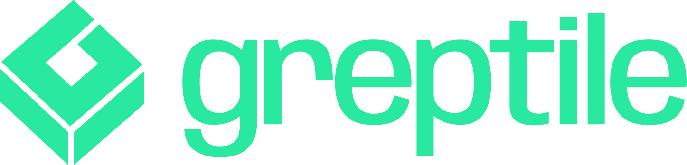
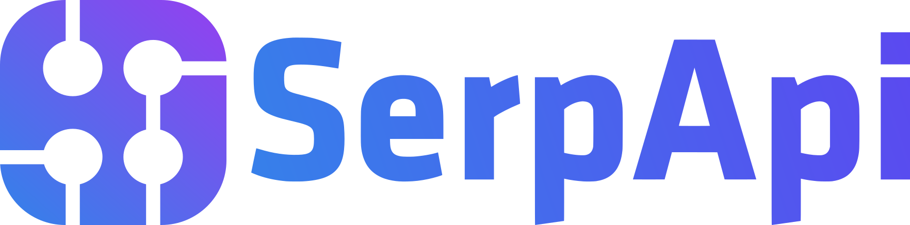
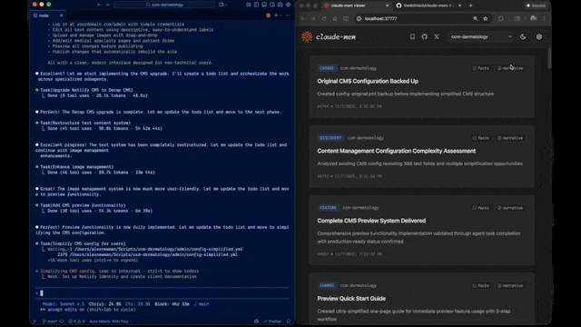

<h1 align="center">
  <br>
  <a href="https://github.com/thedotmack/claude-mem">
    <picture>
      <source media="(prefers-color-scheme: dark)" srcset="../public/claude-mem-logo-for-dark-mode.webp">
      <source media="(prefers-color-scheme: light)" srcset="../public/claude-mem-logo-for-light-mode.webp">
      
    </picture>
  </a>
</h1>

<p align="center">
  
  &nbsp;&nbsp;&nbsp;
  
  &nbsp;&nbsp;&nbsp;
  
</p>

<p align="center">
  <a href="README.zh.md">🇨🇳 中文</a> •
  <a href="README.zh-tw.md">🇹🇼 繁體中文</a> •
  <a href="README.ja.md">🇯🇵 日本語</a> •
  <a href="README.pt.md">🇵🇹 Português</a> •
  <a href="README.pt-br.md">🇧🇷 Português</a> •
  <a href="README.ko.md">🇰🇷 한국어</a> •
  <a href="README.es.md">🇪🇸 Español</a> •
  <a href="README.de.md">🇩🇪 Deutsch</a> •
  <a href="README.fr.md">🇫🇷 Français</a> •
  <a href="README.he.md">🇮🇱 עברית</a> •
  <a href="README.ar.md">🇸🇦 العربية</a> •
  <a href="README.ru.md">🇷🇺 Русский</a> •
  <a href="README.pl.md">🇵🇱 Polski</a> •
  <a href="README.cs.md">🇨🇿 Čeština</a> •
  <a href="README.nl.md">🇳🇱 Nederlands</a> •
  <a href="README.tr.md">🇹🇷 Türkçe</a> •
  <a href="README.uk.md">🇺🇦 Українська</a> •
  <a href="README.vi.md">🇻🇳 Tiếng Việt</a> •
  <a href="README.tl.md">🇵🇭 Tagalog</a> •
  <a href="README.id.md">🇮🇩 Indonesia</a> •
  <a href="README.th.md">🇹🇭 ไทย</a> •
  <a href="README.hi.md">🇮🇳 हिन्दी</a> •
  <a href="README.bn.md">🇧🇩 বাংলা</a> •
  <a href="README.ur.md">🇵🇰 اردو</a> •
  <a href="README.ro.md">🇷🇴 Română</a> •
  <a href="README.sv.md">🇸🇪 Svenska</a> •
  <a href="README.it.md">🇮🇹 Italiano</a> •
  <a href="README.el.md">🇬🇷 Ελληνικά</a> •
  <a href="README.hu.md">🇭🇺 Magyar</a> •
  <a href="README.fi.md">🇫🇮 Suomi</a> •
  <a href="README.da.md">🇩🇰 Dansk</a> •
  <a href="README.no.md">🇳🇴 Norsk</a>
</p>

<h4 align="center">Kodlama ajanınız oturumlar arasında her şeyi unutur. Claude-Mem onun yerine hatırlar.</h4>

<p align="center">
  <a href="../../LICENSE">
    
  </a>
  <a href="../../package.json">
    
  </a>
  <a href="../../package.json">
    
  </a>
  <a href="https://github.com/thedotmack/awesome-claude-code">
    
  </a>
</p>

<p align="center">
 <a href="https://www.star-history.com/thedotmack/claude-mem">
  <picture><source media="(prefers-color-scheme: dark)" srcset="https://api.star-history.com/badge?repo=thedotmack/claude-mem&type=rank&theme=dark" /><source media="(prefers-color-scheme: light)" srcset="https://api.star-history.com/badge?repo=thedotmack/claude-mem&type=rank" /></picture> <picture><source media="(prefers-color-scheme: dark)" srcset="https://api.star-history.com/badge?repo=thedotmack/claude-mem&type=trending&theme=dark" /><source media="(prefers-color-scheme: light)" srcset="https://api.star-history.com/badge?repo=thedotmack/claude-mem&type=trending" /></picture>
 </a>
</p>

<br>

<table align="center">
  <tr>
    <td align="center">
      <a href="https://github.com/thedotmack/claude-mem">
        <picture>
          
        </picture>
      </a>
    </td>
    <td align="center">
      <a href="https://www.star-history.com/#thedotmack/claude-mem&Date">
        <picture>
          <source
            media="(prefers-color-scheme: dark)"
            srcset="https://api.star-history.com/image?repos=thedotmack/claude-mem&type=date&theme=dark&legend=top-left"
          />
          <source
            media="(prefers-color-scheme: light)"
            srcset="https://api.star-history.com/image?repos=thedotmack/claude-mem&type=date&legend=top-left"
          />
          
        </picture>
      </a>
    </td>
  </tr>
</table>

<p align="center">
  <a href="#hızlı-başlangıç">Hızlı başlangıç</a> •
  <a href="#nasıl-çalışır">Nasıl çalışır?</a> •
  <a href="#mcp-arama-araçları">Arama araçları</a> •
  <a href="#belgeler">Belgeler</a> •
  <a href="#yapılandırma">Yapılandırma</a> •
  <a href="#sorun-giderme">Sorun giderme</a> •
  <a href="#lisans">Lisans</a>
</p>

<p align="center">
  Ajanınız her yeni oturuma sıfırdan başlar. Aynı dosyaları yeniden okur, aynı soruları yeniden sorar ve birlikte düzelttiğiniz hataları tekrar yapar.
</p>

<p align="center">
  Claude-Mem, ajanınızın yanında çalışıp yaptıklarını not alan ikinci bir ajan kullanır. Sonraki oturum, önemli bilgilerin kısa bir diziniyle başlar; ayrıntılar yalnızca gerektiğinde getirilir. Claude Code, Codex, Cursor, OpenCode ve 11 ajan daha desteklenir. Copilot CLI, Goose, Roo Code, Warp ve Zed belleğinizde arama yapabilir, ancak bu ajanların oturumları kaydedilmez.
</p>

---

## Hızlı başlangıç

**Bir yapay zekâ ajanı olarak kullanıcı adına kurulum mu yapıyorsunuz?** Kullanıcı hazırsa kendi bilgisayarında `npx claude-mem install --setup browser` komutunu çalıştırın ve açık bırakın. Komut yerel çalışma ortamını hazırlar, ardından kurulum sayfasını tarayıcıda açar. Sayfa açılmazsa ekrana yazdırılan URL'yi kullanıcıya iletin. Ajanlar, entegrasyonlar, beceriler, model, kullanım analitiği ve isteğe bağlı e-posta adresiyle ilgili tüm seçimleri kullanıcı bu sayfada yapar; terminaldeki soruları aktarmanız gerekmez. Kullanıcı hazır değilse `npx claude-mem install --setup defer` komutunu çalıştırın. Bu komut çalışma ortamını hazırlar ve kurulumu kullanıcının ilk ziyaretine kadar bekletir; sonraki oturumda bağlantı gösterilir. Kullanıcı adına seçim yapmayın.

```bash
npx claude-mem install
```

Kurulum aracı bilgisayarınızdaki ajanları bulur ve hangilerini yapılandırmak istediğinizi sorar. Ardından çalışmaya başlayabilirsiniz: gözlemler ilk isteminizden itibaren kaydedilir ve projedeki ikinci oturumunuz ilk oturumun belleğiyle açılır. Copilot CLI, Goose, Roo Code, Warp ve Zed yalnızca bellek aramasını destekler; bu ajanların oturumları belleğe eklenmez.

Kurulum aracı önce gerekli bileşenleri hazırlar, ardından tarayıcıda Claude-Mem hesabınıza giriş yapmanızı ister. Giriş, e-postanıza gönderilen bağlantıyla yapılır ve kart gerektirmez. Sonrasında **claude-mem observer** seçeneğini seçerseniz ödeme yöntemi isteyen bir ödeme sayfasında **30 günlük ücretsiz deneme** başlatılır. Bu işlem tamamlandığında kurulum aracı bellek anahtarınızı kaydeder. Bu gözlemciyle bellek işlemleri planınızın kotasından düşmez; böylece planınızdan %100'e kadar daha fazla kullanım elde edebilirsiniz. Ücretsiz deneme bittiğinde abone olmazsanız bellek işlemleri otomatik olarak Anthropic planınıza döner. Giriş yaptıktan sonra bellek sağlayıcınızı seçersiniz: claude-mem observer, kendi OpenRouter veya Gemini anahtarınız ya da Anthropic planınız.

Giriş adımını atlamak için `--provider` seçeneğiyle bir sağlayıcı belirtin, `CLAUDE_MEM_ONLINE_OPTIN=false` ayarını kullanın veya kurulumu CI ortamında ya da etkileşimsiz bir kabukta çalıştırın. Bu durumlarda kurulum, hesap işlemi gerektirmeden tamamlanır.

Belleğiniz bilgisayarınızdaki `~/.claude-mem` dizininde saklanır. Bulut eşitlemesi yalnızca siz etkinleştirirseniz çalışır. Anonim kullanım analitiği varsayılan olarak açıktır; kapatmak için `npx claude-mem telemetry disable` komutunu kullanın ([toplanan veriler](https://docs.claude-mem.ai/telemetry)).

Claude Code içindeki eklenti pazarından da kurabilirsiniz:

```bash
/plugin marketplace add thedotmack/claude-mem

/plugin install claude-mem
```

Claude Code'u yeniden başlatın. Önceki oturumların bağlamı yeni oturumlarda otomatik olarak kullanılabilir olur.

> **Not:** Claude-Mem npm'de de yayımlanır, ancak `npm install -g claude-mem` yalnızca **SDK/kütüphaneyi** kurar. Eklentinin olay kancalarını (hook) kaydetmez ve arka plan hizmetini (worker) kurmaz. Kurulum için her zaman `npx claude-mem install` veya yukarıdaki `/plugin` komutlarını kullanın.

### Diğer ajanlar

`npx claude-mem install` desteklenen tüm ajanları kapsar. Belirli bir ajanı doğrudan yapılandırmak için `--ide` seçeneğini kullanın.

**OpenCode** (OpenCode 2 dahil, 1.3.4 ve üzeri). Kurulumdan sonra OpenCode'u yeniden başlatın.

```bash
npx claude-mem install --ide opencode
```

**T3 Code** (Codex ve Claude Code sağlayıcıları). Kurulum aracı T3 Code'da etkin sağlayıcıları bulur, yerel Claude-Mem eklentilerini bu sağlayıcıların yapılandırılmış ana dizinlerine kaydeder ve T3 tarafından yönetilen Codex'i destekler. T3 Code'u yeniden başlatın, istendiğinde sağlayıcının olay kancalarına güven izni verin ve yeni bir sohbet başlatın. Özel sunucu ayarları, durum bilgisi ve kaldırma işlemleri için [T3 Code entegrasyon kılavuzuna](https://docs.claude-mem.ai/t3code-integration) bakın.

```bash
npx claude-mem install --ide t3code
```

**Antigravity CLI** ([kurulum kılavuzu](https://docs.claude-mem.ai/antigravity-cli/setup)):

```bash
npx claude-mem install --ide antigravity
```

**OMP (Oh My Pi):**

```bash
npx claude-mem install --ide omp
```

**Pi ve DeepSeek Harness**, arka plan hizmetini kullanır. Kayıt, bellekten bilgi getirme ve sorun giderme için [yerel entegrasyon kurulumuna](../native-harness-integrations.md) bakın.

```bash
npx claude-mem install --ide pi
npx claude-mem install --ide dsh --dsh-profile tui
```

**Grok Bot:** Aşağıdaki [Grok Bot](#grok-bot) bölümüne bakın.

```bash
npx claude-mem install --ide grok-bot
```

`--ide` seçeneğinin tüm değerlerini `npx claude-mem --help` komutuyla görebilirsiniz.

#### Grok Bot

Grok Bot'un olay kancaları olmadığı için sohbet günlüğü dosyaları izlenir. Varsayılan sağlayıcı, barındırılan bellek hizmeti CMEM Pro'dur. Yerel gözlemciyi kullanmak için `--provider host` seçeneğini açıkça belirtin. Bu eklentinin kurulması Cursor'ı kurmaz.

**İsteğe bağlı farkındalık notları:** Önemli gözlemler (`decision`, `bugfix`, `security_alert`, `sensitive`), botun `memory/log/YYYY-MM.md` dosyasına tarihli `- YYYY-MM-DD [awareness] …` satırları olarak eklenir. Grok Bot bu günlüğü zaten diskten yeniden okur. Bu işlem `profile.md` dosyasına, kullanıcı belleğine veya proje belleğine yazmaz. Etkinleştirmek için `CLAUDE_MEM_GROK_BOT_AWARENESS_ENABLED=true` ayarını kullanın ve `CLAUDE_MEM_GROK_BOT_AWARENESS_AGENT_IDS` değerine ajanlarınızın UUID'lerini girin (varsayılan olarak boştur).

#### 🦞 OpenClaw Gateway

Claude-Mem'i tek komutla [OpenClaw](https://openclaw.ai) ağ geçitlerine kalıcı bellek eklentisi olarak kurun:

```bash
curl -fsSL https://install.cmem.ai/openclaw.sh | bash
```

Kurulum aracı bağımlılıkları, eklenti kurulumunu, yapay zekâ sağlayıcısının yapılandırmasını ve arka plan hizmetinin başlatılmasını yönetir. İsterseniz Telegram, Discord, Slack ve diğer platformlara gerçek zamanlı gözlem akışları da gönderir. Ayrıntılar için [OpenClaw entegrasyon kılavuzuna](https://docs.claude-mem.ai/openclaw-integration) bakın.

## Neler sunar?

- 🧠 **Sonraki oturum kaldığınız yerden başlar.** Her oturum, geçmiş gözlemlerin kısa bir diziniyle açılır. Katmanlı yapı sayesinde ajan yalnızca gerektiğinde ayrıntıları açar. Başlık bölümünde her katmanın token maliyeti gösterilebilir.
- 🔍 **Üzerinde çalıştığınız konuları bulun.** mem-search becerisi proje geçmişinizi üç adımda arar: dizin, zaman çizelgesi ve ayrıntılar. Böylece ajan yalnızca açtığı bilgiler için token harcar.
- 🖥️ **Çalışmaları canlı izleyin ve takip edin.** Çalışmalarım (My Work), başlangıçta ekrana yazdırılan arka plan hizmeti URL'sinde canlı istekleri, ilerlemeyi, size devredilen işleri ve kayıtlı inceleme kuyruğunu gösterir. [Kullanım kılavuzu](https://docs.claude-mem.ai/usage/my-work). Bellek, oturumlar ve ayarlar `/viewer` adresindedir.
- 👥 **İsterseniz ekibinizle paylaşın.** TeamBrain, Çalışmalarım'ın yanında sunulan isteğe bağlı bir ortak çalışma alanıdır. Ekip iş listelerini, kimin ne yaptığını ve bağlantılı bulguları gösterir. Herkes ne paylaşacağını kendisi seçer; kişisel istekler ve inceleme notları ayrı tutulur. [Ekip oluşturun](https://cmem.ai/teambrain/start).
- 💻 **Claude Desktop'tan arama yapın.** Claude Desktop konuşmalarınızdan belleğinizde arama yapabilirsiniz.
- 🔒 **Hassas bilgileri kaydın dışında tutun.** `<private>` etiketleri arasına aldığınız içerikler saklanmaz.
- 🖼️ **Ekran görüntüleri varsayılan olarak saklanır.** Araçların aldığı ekran görüntülerinin dönüştürülmüş kopyaları `~/.claude-mem/media-v1/` altında tutulur ve Çalışmalarım'da gösterilir. Görüntüler yalnızca bulut eşitlemesi açıksa cmem.ai'a yüklenir; gözlemci modele ise yalnızca görüntü işleme ayrıca etkinleştirilmişse gönderilir. Saklamayı Ayarlar'daki “Keep images” (Görüntüleri sakla) seçeneğiyle kapatabilirsiniz ([ayrıntılar](https://docs.claude-mem.ai/configuration#screenshots-and-images)).
- ⚙️ **Oturuma hangi bağlamın ekleneceğini seçin.** Yeni oturumun başlangıcında kullanılacak bilgileri ayrıntılı ayarlarla belirleyin.
- 🤖 **Ek işlem gerektirmez.** Kurulumdan sonra kendiliğinden çalışır.
- 🔗 **Geçmiş çalışmalara atıfta bulunun.** Her gözlemin bir kimliği vardır. Bu kimlikle arka plan hizmetinin API'si üzerinden gözleme atıfta bulunabilir veya gözlemi web görüntüleyicisinde açabilirsiniz.

---

## Belgeler

📚 **[Tüm belgeler](https://docs.claude-mem.ai/)** — Resmî web sitesindeki belgelere göz atın.

### Başlarken

- **[Kurulum kılavuzu](https://docs.claude-mem.ai/installation)** — Hızlı başlangıç ve gelişmiş kurulum
- **[Kullanım kılavuzu](https://docs.claude-mem.ai/usage/getting-started)** — Claude-Mem'in otomatik çalışma biçimi
- **[Arama araçları](https://docs.claude-mem.ai/usage/search-tools)** — Doğal dille proje geçmişinde arama
- **[Bulut eşitlemesi](https://docs.claude-mem.ai/cloud-sync)** — Belleğinizi cmem.ai'a yedekleyin; ayrı bir arka plan programı gerekmez, hizmet her yazma işleminde eşitleme yapar.

### En iyi uygulamalar

- **[Bağlam mühendisliği](https://docs.claude-mem.ai/context-engineering)** — Yapay zekâ ajanlarında bağlamı verimli kullanma ilkeleri
- **[Bilgiyi aşamalı sunma](https://docs.claude-mem.ai/progressive-disclosure)** — Claude-Mem'in oturum başlangıcına bağlam hazırlama yaklaşımı

### Mimari

- **[Genel bakış](https://docs.claude-mem.ai/architecture/overview)** — Sistem bileşenleri ve veri akışı
- **[Mimarinin gelişimi](https://docs.claude-mem.ai/architecture-evolution)** — v3'ten v5'e geçiş
- **[Olay kancalarının mimarisi](https://docs.claude-mem.ai/hooks-architecture)** — Claude-Mem'in yaşam döngüsü kancalarını kullanma biçimi
- **[Olay kancaları başvuru kılavuzu](https://docs.claude-mem.ai/architecture/hooks)** — Tüm kanca tanımlarının açıklamaları
- **[Arka plan hizmeti](https://docs.claude-mem.ai/architecture/worker-service)** — HTTP API'si ve Bun ile yönetim
- **[Veritabanı](https://docs.claude-mem.ai/architecture/database)** — SQLite şeması ve FTS5 araması
- **[Arama mimarisi](https://docs.claude-mem.ai/architecture/search-architecture)** — Chroma vektör veritabanıyla hibrit arama

### Yapılandırma ve geliştirme

- **[Yapılandırma](https://docs.claude-mem.ai/configuration)** — Ortam değişkenleri ve ayarlar
- **[Geliştirme](https://docs.claude-mem.ai/development)** — Derleme, test ve katkı süreci
- **[Sorun giderme](https://docs.claude-mem.ai/troubleshooting)** — Yaygın sorunlar ve çözümleri

---

## Nasıl çalışır?

1. **Ajanınız çalışır.** Ajanın olay kancaları, her araç çağrısını (okuma, düzenleme ve komut çalıştırma işlemlerini) küçük bir yerel arka plan hizmetine iletir.
2. **Gözlemci not alır.** İkinci bir ajan bu etkinlikleri kısa gözlemlere dönüştürür ve oturum bittiğinde bir özet yazar.
3. **Sonraki oturum bu bilgilerle başlar.** Ajanınız, yeni oturumun başında projeyle ilgili gözlemlerin kısa bir dizinini alır. Ayrıntıları yalnızca gerektiğinde getirir.

Bellek bilgileri projedeki ikinci oturumunuzdan itibaren bağlama eklenir. Bunun yerine tüm depoyu önceden tanıtmak isterseniz `/learn-codebase` komutunu çalıştırın (tipik bir depoda yaklaşık 5 dakika sürer; isteğe bağlıdır).

Ayrıntılar için [mimariye genel bakışa](https://docs.claude-mem.ai/architecture/overview) bakın.

### Bileşenler nasıl bir araya gelir?

Katkıda bulunacaklar için ana bileşenler ve konumları:

- **`claude-mem` komutu** (`src/npx-cli/index.ts`): Kurulum, onarım, tanılama, başlatma, arama ve diğer işlemler. Kurulum aracı PATH'e küçük bir başlatıcı ekler; olay kancaları böylece `claude-mem` komutunu doğrudan çalıştırabilir.
- **Olay kancaları** (`src/cli/hook-command.ts`; her ajan için `src/cli/adapters/` altında bir bağdaştırıcı): Her ajan olayı, `claude-mem hook claude-code <event>` gibi kabuk gerektirmeyen bir komut çalıştırır. Claude Code için bu olaylar Setup (`claude --init` / `--maintenance`), SessionStart, UserPromptSubmit, PreToolUse, PostToolUse, PostToolUseFailure, Stop, SubagentStop ve SessionEnd'dir.
- **Arka plan hizmeti** (`src/services/worker-service.ts`; yollar `src/services/worker/http/routes/` altında): Bun tarafından yönetilen yerel bir HTTP hizmetidir. Kancalardan araç etkinliklerini alır, gözlemciyi çalıştırır, görüntüleyiciyi ve aramayı sunar.
- **Gözlemci** (istemler `src/sdk/` altında; her model kaynağının sağlayıcısı `src/services/worker/` altında, örneğin `ClaudeProvider.ts` ve `OpenRouterProvider.ts`): Araç etkinliklerini gözlemlere ve özetlere dönüştürür.
- **Depolama** (`src/services/sqlite/`): `~/.claude-mem/claude-mem.db` konumundaki SQLite veritabanı oturumları, gözlemleri ve özetleri saklar. Chroma, SQLite'ın anahtar kelime aramasına anlamsal arama ekler (`src/services/worker/search/`).
- **Bağlam** (`src/services/context/`): Yeni oturumun başlangıcında kullanılacak bilgi bloğunu oluşturur.
- **Arama** (`src/servers/mcp-server.ts`, `plugin/skills/mem-search/`): MCP araçları ve bu araçları kullanan mem-search becerisi.
- **Görüntüleyici** (`/viewer` adresinde `src/ui/viewer/`, `/` adresinde `src/ui/my-work/`): Bellek, oturumlar, ayarlar ve Çalışmalarım sayfası.
- **Derlenmiş eklenti** (`plugin/`): `npm run build` komutuyla oluşturulur. Değişiklikleri üretilen betiklerde değil, `src/` altında yapın.

Bu bileşenler için kullanılan terimler ve ürünün anlatımı [docs/story.md](../story.md) dosyasında açıklanır.

---

## MCP arama araçları

Arama, token kullanımını sınırlayan üç adımlı bir iş akışında üç MCP aracıyla yapılır. mem-search becerisi bu süreci sizin için yönetir.

**Üç adım:**

1. **`search`** — Kimlikleri içeren kısa bir dizin alın (sonuç başına yaklaşık 50–100 token).
2. **`timeline`** — İlgili sonuçların öncesinde ve sonrasında neler olduğunu görün.
3. **`get_observations`** — Yalnızca seçtiğiniz kimliklerin tüm ayrıntılarını getirin (sonuç başına yaklaşık 500–1.000 token).

**Adım adım işleyiş:**

- Ajanınız belleğinizde arama yapmak için MCP araçlarını kullanır.
- Sonuç dizinini almak için `search` ile başlar.
- Belirli gözlemlerin çevresindeki olayları görmek için `timeline` kullanır.
- İlgili kimliklerin tüm ayrıntılarını `get_observations` ile getirir.
- **Dizin satırları tam bir kaydın yaklaşık onda biri boyutundadır:** Yaklaşık 500–1.000 token yerine 50–100 token. Filtreleme, her kaydın boyutunu değil, kaç kaydın getirileceğini belirler. Toplam maliyete zaman çizelgesi ve seçilen ayrıntılar da dahildir. Bu oran, aramada ilgili kayıtları bulma başarısının veya uçtan uca tasarrufun ölçümü değildir ([#4138](https://github.com/thedotmack/claude-mem/issues/4138)).

**Kullanılabilir MCP araçları:**

1. **`search`** — Bellek dizininde tam metin sorgularıyla arama yapın; türe, tarihe veya projeye göre filtreleyin.
2. **`timeline`** — Belirli bir gözlemin veya sorgunun çevresindeki olayları zaman sırasıyla getirin.
3. **`get_observations`** — Kimliklere göre gözlemlerin tüm ayrıntılarını getirin (birden fazla kimliği her zaman toplu olarak sorgulayın).

**Kullanım örneği:**

```typescript
// Adım 1: Sonuç dizinini getirmek için arama yapın
search(query="authentication bug", type="bugfix", limit=10)

// Adım 2: Dizini inceleyip ilgili kimlikleri belirleyin (ör. #123, #456)

// Adım 3: Tüm ayrıntıları getirin
get_observations(ids=[123, 456])
```

Arka plan hizmeti ayrıca kodda gezinme (`smart_search`, `smart_outline`, `smart_unfold`), açıkça not kaydetme (`save_memory`) ve devam eden işleri takip etme araçları sunar. Ayrıntılı örnekler için [arama araçları kılavuzuna](https://docs.claude-mem.ai/usage/search-tools) bakın.

---

## Sistem gereksinimleri

- **Node.js**: 20.x serisinde 20.19 ve üzeri ya da 22.12 ve üzeri
- **Desteklenen bir ajan**: Claude Code'un eklenti destekleyen en güncel sürümü veya [diğer ajanlardan](#diğer-ajanlar) biri
- **Bun**: JavaScript çalışma zamanı ve süreç yöneticisi (yoksa otomatik kurulur)
- **uv**: Vektör araması için Python paket yöneticisi (yoksa otomatik kurulur)
- **SQLite 3**: Kalıcı depolama için (pakete dahildir)

---

### Windows kurulum notları

Şu hatayı görürseniz:

```powershell
npm : The term 'npm' is not recognized as the name of a cmdlet
```

Node.js ve npm'in kurulu olduğundan ve PATH'e eklendiğinden emin olun. [nodejs.org](https://nodejs.org) adresinden en güncel Node.js kurulum dosyasını indirin ve kurulumdan sonra terminalinizi yeniden başlatın.

Claude Code'un olay kancaları Git Bash gerektirmez. Her kanca `claude-mem` komutunu doğrudan çalıştırır. `npx claude-mem install`, başlatıcıyı `%LOCALAPPDATA%\claude-mem\bin\claude-mem.exe` konumuna yerleştirir ve bu klasörü kullanıcı Path değişkenine ekler. Claude Code'un yeni Path değerini alması için terminalinizi veya geliştirme ortamınızı yeniden başlatın. Kancalar `Executable not found in $PATH: "claude-mem"` hatasını verirse `npx claude-mem doctor` komutunu çalıştırın ve [sorun giderme kılavuzuna](https://docs.claude-mem.ai/troubleshooting#claude-mem-command-not-found-in-hooks) bakın.

---

## Yapılandırma

Ayarlar `~/.claude-mem/settings.json` dosyasında tutulur. Bu dosya ilk çalıştırmada varsayılan değerlerle otomatik olarak oluşturulur. Yapay zekâ modelini, arka plan hizmetinin portunu, veri dizinini, günlük düzeyini ve oturuma bağlam ekleme ayarlarını buradan yapılandırabilirsiniz.

Claude Code ve Codex'in SessionStart bağlamına tüm ajanlardan gelen gözlemleri dahil etmek için bu dosyada `"CLAUDE_MEM_SESSION_START_INCLUDE_ALL_SOURCES": "true"` ayarını kullanın veya görüntüleyici ayarlarındaki **Include all sources at session start** (Oturum başlangıcında tüm kaynakları dahil et) seçeneğini etkinleştirin. Varsayılan `"false"` değeri, başlangıç bağlamını kullanılan ajanla sınırlar. Gözlem sayısı sınırı, seçilen tüm kaynakların toplamına uygulanır.

Tüm ayarlar ve örnekler için **[yapılandırma kılavuzuna](https://docs.claude-mem.ai/configuration)** bakın.

### Mod ve dil ayarları

Claude-Mem, `CLAUDE_MEM_MODE` ayarıyla birden fazla iş akışı modunu ve dili destekler.

Bu ayar şunları belirler:

- İş akışının davranışını (ör. code, chill, investigation)
- Oluşturulan gözlemlerin dilini

#### Nasıl ayarlanır?

`~/.claude-mem/settings.json` dosyanızı düzenleyin. Türkçe için:

```json
{
  "CLAUDE_MEM_MODE": "code--tr"
}
```

Modlar `plugin/modes/` dizininde tanımlanır. Yerel kurulumdaki tüm modları görmek için:

```bash
ls ~/.claude/plugins/marketplaces/thedotmack/plugin/modes/
```

#### Kullanılabilir modlar

| Mod | Açıklama |
| --- | --- |
| `code` | Varsayılan İngilizce mod |
| `code--chill` | Yeniden keşfetmesi zahmetli olacak bilgileri tutarak daha az gözlem kaydeder |
| `code--[lang]` | `code` ile aynı davranış; gözlemler ve özetler seçilen dilde yazılır |
| `code--tr` | Türkçe gözlemler ve özetler |

Yerleşik dil kodları: `ar`, `bn`, `cs`, `da`, `de`, `el`, `es`, `fi`, `fr`, `he`, `hi`, `hu`, `id`, `it`, `ja`, `ko`, `nl`, `no`, `pl`, `pt-br`, `ro`, `ru`, `sv`, `th`, `tr`, `uk`, `ur`, `vi`, `zh`. Örneğin `code--ko`, gözlemleri ve özetleri Korece yazar.

Dillerin adları, e-posta inceleme modu ve özel modlar için [modlar kılavuzuna](https://docs.claude-mem.ai/modes) bakın.

> **Not:** Bu modların tümü pakete dahildir. Ek kurulum veya eklenti güncellemesi gerekmez.

#### Modu değiştirdikten sonra

Yeni mod ayarının uygulanması için Claude Code'u yeniden başlatın.

---

## Geliştirme

Derleme talimatları, testler ve katkı süreci için **[geliştirme kılavuzuna](https://docs.claude-mem.ai/development)** bakın.

---

## Sorun giderme

Önce `npx claude-mem doctor` komutunu çalıştırın. Bun, uv, kanca başlatıcısı ve arka plan hizmetini kontrol ederek nelerin düzeltilmesi gerektiğini gösterir.

Yaygın sorunlar ve çözümleri için **[sorun giderme kılavuzuna](https://docs.claude-mem.ai/troubleshooting)** bakın.

---

## Hata bildirme

Otomatik rapor oluşturucuyla kapsamlı hata raporları hazırlayın:

```bash
cd ~/.claude/plugins/marketplaces/thedotmack
npm run bug-report
```

## Katkıda bulunma

Katkılarınızı bekliyoruz:

1. Deponun kendi hesabınızda bir kopyasını oluşturun (fork).
2. Değişikliğiniz için bir dal oluşturun.
3. Değişikliklerinizi yapın ve ilgili testleri ekleyin.
4. Belgeleri güncelleyin. Kullanıcıya yönelik metinlerde [docs/story.md](../story.md) dosyasındaki anlatım kurallarını izleyin.
5. `main` dalına yönelik bir pull request açın.

Sürümler `main` dalından çıkarılır ve npm'de yayımlanır.

Katkı süreci için [geliştirme kılavuzuna](https://docs.claude-mem.ai/development) bakın.

---

## Lisans

Claude-Mem, Apache License 2.0 ile lisanslanmıştır.

Kalıcı ajan belleğinin geliştirici araçlarına, yerel ajanlara, MCP sunucularına, kurumsal sistemlere, robotik yazılım sistemlerine ve üretimde kullanılan ajan altyapılarına kolayca entegre edilebilmesi için Apache-2.0'ı seçtik.

Ayrıntılar için [LICENSE](../../LICENSE) dosyasına bakın. Lisansın kapsamı ve açık kaynak ile ticari bileşenler arasındaki sınır, [docs/license.md](../license.md) ve [docs/ip-boundary.md](../ip-boundary.md) dosyalarında açıklanır.

---

## Destek

- **Belgeler**: [docs/](../)
- **Hata ve sorun bildirimleri**: [GitHub Issues](https://github.com/thedotmack/claude-mem/issues)
- **Depo**: [github.com/thedotmack/claude-mem](https://github.com/thedotmack/claude-mem)
- **Resmî X hesabı**: [@Claude_Memory](https://x.com/Claude_Memory)
- **Resmî Discord**: [Discord'a katılın](https://discord.com/invite/J4wttp9vDu)
- **Geliştirici**: Alex Newman ([@thedotmack](https://github.com/thedotmack))

---

**Claude Agent SDK ile geliştirildi** | **Claude Code, Codex, Cursor, OpenCode ve diğer ajanlarla çalışır** | **TypeScript ile yazıldı**

---

### CMEM nedir?

CMEM, üçüncü bir tarafın oluşturduğu ve Claude-Mem'in geliştiricisi Alex Newman'ın (@thedotmack) resmen desteklediği bir kripto tokendir. Topluluğun büyümesine katkıda bulunmayı ve CMEM'i ona en çok ihtiyaç duyan geliştiricilere ve bilgi çalışanlarına ulaştırmayı amaçlar.

BASE ağındaki resmî sözleşme adresi: 0x76b1967eec0ccaeb001bbbb2b40dc4badba31ba3
