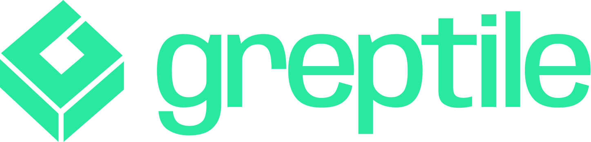
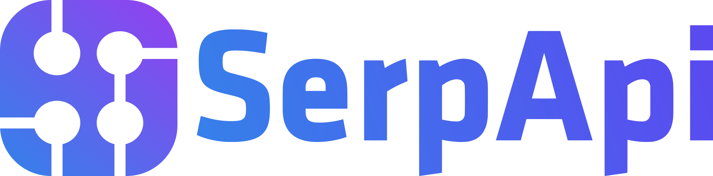
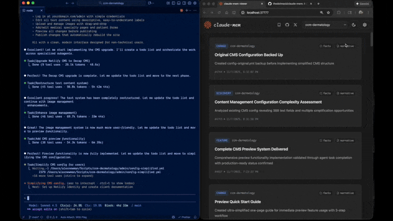

🌐 Bản dịch này được tạo bằng máy và đã được cộng đồng rà soát. Bản gốc: [README tiếng Anh](../../README.md). Đồng bộ lần cuối: 5/11/2026. Hoan nghênh mọi góp ý chỉnh sửa!

<h1 align="center">
  <br>
  <a href="https://github.com/thedotmack/claude-mem">
    <picture>
      <source media="(prefers-color-scheme: dark)" srcset="../public/claude-mem-logo-for-dark-mode.webp">
      <source media="(prefers-color-scheme: light)" srcset="../public/claude-mem-logo-for-light-mode.webp">
      
    </picture>
  </a>
</h1>

<p align="center">
  
  &nbsp;&nbsp;&nbsp;
  
  &nbsp;&nbsp;&nbsp;
  
</p>

<p align="center">
  <a href="../../README.md">🇺🇸 English</a> •
  <a href="README.zh.md">🇨🇳 中文</a> •
  <a href="README.zh-tw.md">🇹🇼 繁體中文</a> •
  <a href="README.ja.md">🇯🇵 日本語</a> •
  <a href="README.pt.md">🇵🇹 Português</a> •
  <a href="README.pt-br.md">🇧🇷 Português</a> •
  <a href="README.ko.md">🇰🇷 한국어</a> •
  <a href="README.es.md">🇪🇸 Español</a> •
  <a href="README.de.md">🇩🇪 Deutsch</a> •
  <a href="README.fr.md">🇫🇷 Français</a> •
  <a href="README.he.md">🇮🇱 עברית</a> •
  <a href="README.ar.md">🇸🇦 العربية</a> •
  <a href="README.ru.md">🇷🇺 Русский</a> •
  <a href="README.pl.md">🇵🇱 Polski</a> •
  <a href="README.cs.md">🇨🇿 Čeština</a> •
  <a href="README.nl.md">🇳🇱 Nederlands</a> •
  <a href="README.tr.md">🇹🇷 Türkçe</a> •
  <a href="README.uk.md">🇺🇦 Українська</a> •
  <a href="README.vi.md">🇻🇳 Tiếng Việt</a> •
  <a href="README.tl.md">🇵🇭 Tagalog</a> •
  <a href="README.id.md">🇮🇩 Indonesia</a> •
  <a href="README.th.md">🇹🇭 ไทย</a> •
  <a href="README.hi.md">🇮🇳 हिन्दी</a> •
  <a href="README.bn.md">🇧🇩 বাংলা</a> •
  <a href="README.ur.md">🇵🇰 اردو</a> •
  <a href="README.ro.md">🇷🇴 Română</a> •
  <a href="README.sv.md">🇸🇪 Svenska</a> •
  <a href="README.it.md">🇮🇹 Italiano</a> •
  <a href="README.el.md">🇬🇷 Ελληνικά</a> •
  <a href="README.hu.md">🇭🇺 Magyar</a> •
  <a href="README.fi.md">🇫🇮 Suomi</a> •
  <a href="README.da.md">🇩🇰 Dansk</a> •
  <a href="README.no.md">🇳🇴 Norsk</a>
</p>

<h4 align="center">Hệ thống nén bộ nhớ lâu dài dành cho <a href="https://claude.com/claude-code" target="_blank">Claude Code</a>.</h4>

<p align="center">
  <a href="../../LICENSE">
    
  </a>
  <a href="../../package.json">
    
  </a>
  <a href="../../package.json">
    
  </a>
  <a href="https://github.com/thedotmack/awesome-claude-code">
    
  </a>
</p>

<p align="center">
 <a href="https://www.star-history.com/thedotmack/claude-mem">
  <picture><source media="(prefers-color-scheme: dark)" srcset="https://api.star-history.com/badge?repo=thedotmack/claude-mem&type=rank&theme=dark" /><source media="(prefers-color-scheme: light)" srcset="https://api.star-history.com/badge?repo=thedotmack/claude-mem&type=rank" /></picture> <picture><source media="(prefers-color-scheme: dark)" srcset="https://api.star-history.com/badge?repo=thedotmack/claude-mem&type=trending&theme=dark" /><source media="(prefers-color-scheme: light)" srcset="https://api.star-history.com/badge?repo=thedotmack/claude-mem&type=trending" /></picture>
 </a>
</p>

<br>

<table align="center">
  <tr>
    <td align="center">
      <a href="https://github.com/thedotmack/claude-mem">
        <picture>
          
        </picture>
      </a>
    </td>
    <td align="center">
      <a href="https://www.star-history.com/#thedotmack/claude-mem&Date">
        <picture>
          <source
            media="(prefers-color-scheme: dark)"
            srcset="https://api.star-history.com/image?repos=thedotmack/claude-mem&type=date&theme=dark&legend=top-left"
          />
          <source
            media="(prefers-color-scheme: light)"
            srcset="https://api.star-history.com/image?repos=thedotmack/claude-mem&type=date&legend=top-left"
          />
          
        </picture>
      </a>
    </td>
  </tr>
</table>

<p align="center">
  <a href="#bắt-đầu-nhanh">Bắt đầu nhanh</a> •
  <a href="#cách-hoạt-động">Cách hoạt động</a> •
  <a href="#công-cụ-tìm-kiếm-mcp">Công cụ tìm kiếm</a> •
  <a href="#tài-liệu">Tài liệu</a> •
  <a href="#cấu-hình">Cấu hình</a> •
  <a href="#khắc-phục-sự-cố">Khắc phục sự cố</a> •
  <a href="#giấy-phép">Giấy phép</a>
</p>

<p align="center">
  Claude-Mem giữ ngữ cảnh liền mạch giữa các phiên làm việc: tự động ghi lại quan sát (observation) về việc sử dụng công cụ, tạo bản tóm tắt ngữ nghĩa và đưa chúng vào các phiên sau. Nhờ vậy, Claude vẫn nắm được kiến thức về dự án ngay cả khi phiên làm việc đã kết thúc hoặc kết nối lại.
</p>

---

## Bắt đầu nhanh

Cài đặt claude-mem cho Grok Bot:

```bash
npx claude-mem install --ide grok-bot
```

Grok Bot không có host hook, nên claude-mem theo dõi các tệp log trò chuyện. Mặc định dùng CMEM Pro, dịch vụ bộ nhớ được lưu trữ trực tuyến. Observer chạy cục bộ là tùy chọn: `--provider host`. Cài đặt plugin này không cài Cursor.

**Thử nghiệm đẩy thông tin nhận biết (LFG + Orifice):** các quan sát quan trọng (`decision`, `bugfix`, `security_alert`, `sensitive`) được ghi thêm thành các dòng có ngày `- YYYY-MM-DD [awareness] …` vào tệp `memory/log/YYYY-MM.md` của bot đó. Grok Bot vốn đã đọc lại log từ ổ đĩa. Tính năng này không ghi vào `profile.md`, user-memory hay bộ nhớ dự án. Tắt bằng `CLAUDE_MEM_GROK_BOT_AWARENESS_ENABLED=false`.

Cài đặt chỉ với một lệnh:

```bash
npx claude-mem install
```

Trình cài đặt thiết lập mọi thứ trước, sau đó yêu cầu bạn đăng nhập claude-mem trên trình duyệt (bằng magic link qua email, không cần thẻ). Khi đăng nhập, tài khoản của bạn được cấp một memory key và mở khóa **claude-mem observer** với **30 ngày dùng thử miễn phí**: bộ nhớ chạy ngoài gói của bạn, nên bạn có thêm tới 100% lượt dùng từ gói hiện tại. Khi hết thời gian dùng thử, bộ nhớ tự động chuyển về dùng gói Anthropic của bạn, trừ khi bạn đăng ký. Sau khi đăng nhập, bạn chọn nhà cung cấp bộ nhớ: claude-mem observer, key OpenRouter hoặc Gemini của riêng bạn, hoặc gói Anthropic của bạn.

Muốn bỏ qua bước đăng nhập? Truyền cờ `--provider` cụ thể, đặt `CLAUDE_MEM_ONLINE_OPTIN=false`, hoặc chạy trong CI hay shell không tương tác: trình cài đặt sẽ hoàn tất mà không cần tài khoản.

Hoặc cài đặt cho OpenCode:

```bash
npx claude-mem install --ide opencode
```

Hỗ trợ OpenCode 1.3.4 trở lên, kể cả OpenCode 2. Khởi động lại OpenCode sau khi cài đặt.

Hoặc cài đặt cho **T3 Code** (các provider Codex và Claude Code):

```bash
npx claude-mem install --ide t3code
```

Trình cài đặt tự tìm các provider đang bật trong T3 Code, đăng ký plugin Claude-Mem gốc vào thư mục home đã cấu hình của từng provider, và hỗ trợ Codex do T3 quản lý. Khởi động lại T3 Code, tin cậy (trust) các hook của provider khi được hỏi, rồi mở một thread mới. Xem [hướng dẫn tích hợp T3 Code](https://docs.claude-mem.ai/t3code-integration) để biết cách cấu hình server tùy chỉnh, xem trạng thái và gỡ cài đặt.

Hoặc cài đặt cho Antigravity CLI ([hướng dẫn cài đặt](https://docs.claude-mem.ai/antigravity-cli/setup)):

```bash
npx claude-mem install --ide antigravity
```

Hoặc cài đặt cho OMP (Oh My Pi):

```bash
npx claude-mem install --ide omp
```

Hoặc cài đặt extension Pi gốc hoặc plugin DeepSeek Harness:

```bash
npx claude-mem install --ide pi
npx claude-mem install --ide dsh --dsh-profile tui
```

Pi và DeepSeek Harness dùng worker runtime. Xem [thiết lập native harness](../native-harness-integrations.md) để biết cách ghi nhận, truy xuất và khắc phục sự cố.

Hoặc cài đặt từ plugin marketplace ngay trong Claude Code:

```bash
/plugin marketplace add thedotmack/claude-mem

/plugin install claude-mem
```

Khởi động lại Claude Code. Ngữ cảnh từ các phiên trước sẽ tự động xuất hiện trong các phiên mới.

> **Lưu ý:** Claude-Mem cũng được phát hành trên npm, nhưng `npm install -g claude-mem` chỉ cài **SDK/thư viện**: lệnh này không đăng ký hook của plugin và không thiết lập worker service. Hãy luôn cài đặt bằng `npx claude-mem install` hoặc các lệnh `/plugin` ở trên.

### 🦞 OpenClaw Gateway

Cài đặt claude-mem làm plugin bộ nhớ lâu dài trên các gateway [OpenClaw](https://openclaw.ai) chỉ với một lệnh:

```bash
curl -fsSL https://install.cmem.ai/openclaw.sh | bash
```

Trình cài đặt lo phần phụ thuộc, thiết lập plugin, cấu hình nhà cung cấp AI, khởi động worker, và tùy chọn gửi luồng quan sát theo thời gian thực đến Telegram, Discord, Slack và nhiều nền tảng khác. Xem [hướng dẫn tích hợp OpenClaw](https://docs.claude-mem.ai/openclaw-integration) để biết chi tiết.

**Tính năng chính:**

- 🧠 **Bộ nhớ lâu dài** - Ngữ cảnh được giữ lại qua các phiên làm việc
- 📊 **Truy xuất theo từng lớp (Progressive Disclosure)** - Truy xuất bộ nhớ theo từng lớp, thấy rõ chi phí token
- 🔍 **Tìm kiếm thông minh (Smart Search, mặc định)** - Truy vấn lịch sử dự án bằng skill mem-search ba bước
- 🖥️ **Local My Work** - Yêu cầu đang chạy, tiến độ, các bước bàn giao cho người và hàng đợi review đã lưu, tại URL worker in ra khi khởi động. [Hướng dẫn](https://docs.claude-mem.ai/usage/my-work). Bộ nhớ, phiên làm việc và cài đặt vẫn nằm ở `/viewer`.
- 👥 **TeamBrain** - Không gian làm việc chung (tùy chọn) bên cạnh My Work, với danh sách công việc thật của nhóm, ghi nhận từng thành viên và các phát hiện được liên kết. Mỗi người tự chọn những gì muốn chia sẻ; yêu cầu cá nhân và ghi chú review được giữ riêng. [Thiết lập nhóm](https://cmem.ai/teambrain/start).
- 💻 **Skill cho Claude Desktop** - Tìm kiếm bộ nhớ từ các cuộc trò chuyện trên Claude Desktop
- 🔒 **Kiểm soát quyền riêng tư** - Dùng thẻ `<private>` để không lưu nội dung nhạy cảm
- 🖼️ **Ảnh chụp màn hình (tùy chọn, tắt theo mặc định)** - Lưu bản chuyển đổi của ảnh chụp màn hình từ công cụ trong `~/.claude-mem/media-v1/`, chỉ tải lên cmem.ai khi bật Cloud Sync, và chỉ gửi cho mô hình observer khi bật riêng tính năng suy luận hình ảnh ([chi tiết](https://docs.claude-mem.ai/configuration#screenshots-and-images-opt-in))
- ⚙️ **Cấu hình ngữ cảnh** - Kiểm soát chi tiết ngữ cảnh nào được đưa vào
- 🤖 **Hoạt động tự động** - Không cần thao tác thủ công
- 🔗 **Trích dẫn** - Tham chiếu các quan sát trước đây bằng ID qua worker API, hoặc xem tất cả trong web viewer

---

## Tài liệu

📚 **[Xem tài liệu đầy đủ](https://docs.claude-mem.ai/)** - Đọc trên trang web chính thức

### Bắt đầu

- **[Hướng dẫn cài đặt](https://docs.claude-mem.ai/installation)** - Bắt đầu nhanh và cài đặt nâng cao
- **[Hướng dẫn sử dụng](https://docs.claude-mem.ai/usage/getting-started)** - Claude-Mem tự động hoạt động như thế nào
- **[Công cụ tìm kiếm](https://docs.claude-mem.ai/usage/search-tools)** - Truy vấn lịch sử dự án bằng ngôn ngữ tự nhiên
- **[Cloud Sync](https://docs.claude-mem.ai/cloud-sync)** - Sao lưu bộ nhớ lên cmem.ai, không cần daemon: worker đồng bộ ngay khi ghi

### Thực hành tốt nhất

- **[Context Engineering](https://docs.claude-mem.ai/context-engineering)** - Các nguyên tắc tối ưu ngữ cảnh cho AI agent
- **[Truy xuất theo từng lớp (Progressive Disclosure)](https://docs.claude-mem.ai/progressive-disclosure)** - Triết lý đằng sau chiến lược nạp ngữ cảnh của Claude-Mem

### Kiến trúc

- **[Tổng quan](https://docs.claude-mem.ai/architecture/overview)** - Các thành phần hệ thống và luồng dữ liệu
- **[Quá trình phát triển kiến trúc](https://docs.claude-mem.ai/architecture-evolution)** - Hành trình từ v3 đến v5
- **[Kiến trúc hook](https://docs.claude-mem.ai/hooks-architecture)** - Claude-Mem dùng lifecycle hook như thế nào
- **[Tham chiếu hook](https://docs.claude-mem.ai/architecture/hooks)** - Giải thích từng hook
- **[Worker Service](https://docs.claude-mem.ai/architecture/worker-service)** - HTTP API và cách quản lý bằng Bun
- **[Cơ sở dữ liệu](https://docs.claude-mem.ai/architecture/database)** - Schema SQLite và tìm kiếm FTS5
- **[Kiến trúc tìm kiếm](https://docs.claude-mem.ai/architecture/search-architecture)** - Tìm kiếm kết hợp với cơ sở dữ liệu vector Chroma

### Cấu hình và phát triển

- **[Cấu hình](https://docs.claude-mem.ai/configuration)** - Biến môi trường và cài đặt
- **[Phát triển](https://docs.claude-mem.ai/development)** - Build, kiểm thử, đóng góp
- **[Khắc phục sự cố](https://docs.claude-mem.ai/troubleshooting)** - Các sự cố thường gặp và cách xử lý

---

## Cách hoạt động

**Các thành phần cốt lõi:**

1. **Lifecycle hook** - SessionStart, UserPromptSubmit, PreToolUse, PostToolUse, Stop, SessionEnd. Mỗi hook là một lệnh không cần shell, `claude-mem hook claude-code <event>`, được chạy bởi một launcher nhỏ mà trình cài đặt đặt vào PATH
2. **Smart Install** - Trình kiểm tra phụ thuộc có cache (Setup hook khi chạy `claude --init` / `--maintenance`, cùng với `npx claude-mem install` / `repair`)
3. **Worker Service** - HTTP API cục bộ với giao diện web viewer và các endpoint tìm kiếm, do Bun quản lý
4. **SQLite Database** - Lưu phiên làm việc, quan sát và bản tóm tắt
5. **Skill mem-search** - Truy vấn bằng ngôn ngữ tự nhiên, truy xuất theo từng lớp
6. **Chroma Vector Database** - Tìm kiếm kết hợp ngữ nghĩa và từ khóa để truy xuất ngữ cảnh thông minh

Xem [tổng quan kiến trúc](https://docs.claude-mem.ai/architecture/overview) để biết chi tiết.

---

## Công cụ tìm kiếm MCP

Claude-Mem cung cấp tìm kiếm bộ nhớ thông minh qua **4 công cụ MCP**, theo **quy trình 3 lớp** tiết kiệm token:

**Quy trình 3 lớp:**

1. **`search`** - Lấy chỉ mục gọn kèm ID (~50-100 token/kết quả)
2. **`timeline`** - Lấy ngữ cảnh theo thứ tự thời gian quanh các kết quả đáng chú ý
3. **`get_observations`** - Chỉ lấy chi tiết đầy đủ cho các ID đã lọc (~500-1.000 token/kết quả)

**Cách hoạt động:**
- Claude dùng các công cụ MCP để tìm kiếm trong bộ nhớ của bạn
- Bắt đầu với `search` để lấy chỉ mục kết quả
- Dùng `timeline` để xem điều gì đang diễn ra quanh một quan sát cụ thể
- Dùng `get_observations` để lấy chi tiết đầy đủ cho các ID liên quan
- **Tiết kiệm ~10 lần token** nhờ lọc trước khi lấy chi tiết

**Các công cụ MCP có sẵn:**

1. **`search`** - Tìm trong chỉ mục bộ nhớ bằng truy vấn toàn văn, lọc theo loại/ngày/dự án
2. **`timeline`** - Lấy ngữ cảnh theo thứ tự thời gian quanh một quan sát hoặc truy vấn cụ thể
3. **`get_observations`** - Lấy chi tiết đầy đủ của quan sát theo ID (luôn gộp nhiều ID trong một lần gọi)

**Ví dụ sử dụng:**

```typescript
// Step 1: Search for index
search(query="authentication bug", type="bugfix", limit=10)

// Step 2: Review index, identify relevant IDs (e.g., #123, #456)

// Step 3: Fetch full details
get_observations(ids=[123, 456])
```

Xem [hướng dẫn công cụ tìm kiếm](https://docs.claude-mem.ai/usage/search-tools) để biết thêm ví dụ chi tiết.

---

## Yêu cầu hệ thống

- **Node.js**: 20.0.0 trở lên
- **Claude Code**: Phiên bản mới nhất có hỗ trợ plugin
- **Bun**: JavaScript runtime và trình quản lý tiến trình (tự động cài nếu chưa có)
- **uv**: Trình quản lý gói Python cho tìm kiếm vector (tự động cài nếu chưa có)
- **SQLite 3**: Lưu trữ lâu dài (đi kèm sẵn)

---
### Lưu ý khi cài đặt trên Windows

Nếu bạn gặp lỗi như:

```powershell
npm : The term 'npm' is not recognized as the name of a cmdlet
```

Hãy đảm bảo Node.js và npm đã được cài đặt và thêm vào PATH. Tải trình cài đặt Node.js mới nhất tại https://nodejs.org và khởi động lại terminal sau khi cài.

Hook của Claude Code không cần Git Bash. Mỗi hook gọi trực tiếp `claude-mem`, và `npx claude-mem install` đặt launcher đó tại `%LOCALAPPDATA%\claude-mem\bin\claude-mem.exe` rồi thêm thư mục này vào Path của người dùng. Hãy khởi động lại terminal hoặc IDE sau đó để Claude Code nhận Path mới. Nếu hook báo `Executable not found in $PATH: "claude-mem"`, hãy chạy `npx claude-mem doctor` và xem [khắc phục sự cố](https://docs.claude-mem.ai/troubleshooting#claude-mem-command-not-found-in-hooks).

---

## Cấu hình

Cài đặt được quản lý trong `~/.claude-mem/settings.json` (tự động tạo với giá trị mặc định ở lần chạy đầu tiên). Tại đây bạn cấu hình mô hình AI, cổng worker, thư mục dữ liệu, mức log và cách đưa ngữ cảnh vào phiên.

Để đưa quan sát từ mọi harness vào ngữ cảnh SessionStart của Claude Code và Codex, đặt `"CLAUDE_MEM_SESSION_START_INCLUDE_ALL_SOURCES": "true"` trong tệp đó, hoặc bật **Include all sources at session start** trong phần cài đặt của viewer. Mặc định là `"false"`, tức ngữ cảnh lúc khởi động chỉ lấy từ harness hiện tại. Giới hạn số lượng quan sát vẫn áp dụng trên tất cả các nguồn được chọn.

Xem **[hướng dẫn cấu hình](https://docs.claude-mem.ai/configuration)** để biết mọi cài đặt có sẵn và ví dụ.

### Cấu hình chế độ và ngôn ngữ

Claude-Mem hỗ trợ nhiều chế độ làm việc và ngôn ngữ qua cài đặt `CLAUDE_MEM_MODE`.

Tùy chọn này quyết định cả hai:
- Cách thức làm việc (ví dụ: code, chill, investigation)
- Ngôn ngữ dùng trong các quan sát được tạo ra

#### Cách cấu hình

Sửa tệp cài đặt tại `~/.claude-mem/settings.json`:

```json
{
  "CLAUDE_MEM_MODE": "code--vi"
}
```

Các chế độ được định nghĩa trong `plugin/modes/`. Để xem tất cả các chế độ có sẵn trên máy:

```bash
ls ~/.claude/plugins/marketplaces/thedotmack/plugin/modes/
```

#### Các chế độ có sẵn

| Chế độ | Mô tả |
|------------|-------------------------|
| `code` | Chế độ mặc định, tiếng Anh |
| `code--chill` | Ghi ít quan sát hơn, chỉ giữ những gì khó tìm lại |
| `code--[lang]` | Giống `code`, nhưng quan sát và bản tóm tắt được viết bằng ngôn ngữ khác |

Mã ngôn ngữ có sẵn: `ar`, `bn`, `cs`, `da`, `de`, `el`, `es`, `fi`, `fr`, `he`, `hi`, `hu`, `id`, `it`, `ja`, `ko`, `nl`, `no`, `pl`, `pt-br`, `ro`, `ru`, `sv`, `th`, `tr`, `uk`, `ur`, `vi`, `zh`. Ví dụ, `code--vi` ghi bộ nhớ bằng tiếng Việt.

Xem [Modes](https://docs.claude-mem.ai/modes) để biết tên của từng ngôn ngữ, chế độ điều tra email (email investigation) và cách tạo chế độ tùy chỉnh.

> Lưu ý: Tất cả các chế độ này đều có sẵn, kể cả quan sát bằng tiếng Việt (`code--vi`). Không cần cài thêm hay cập nhật plugin.

#### Sau khi thay đổi chế độ

Khởi động lại Claude Code để áp dụng chế độ mới.

---

## Phát triển

Xem **[hướng dẫn phát triển](https://docs.claude-mem.ai/development)** để biết cách build, kiểm thử và quy trình đóng góp.

---

## Khắc phục sự cố

Nếu gặp sự cố, hãy mô tả vấn đề cho Claude; skill troubleshoot sẽ tự động chẩn đoán và đưa ra cách sửa.

Xem **[hướng dẫn khắc phục sự cố](https://docs.claude-mem.ai/troubleshooting)** để biết các sự cố thường gặp và cách xử lý.

---

## Báo cáo lỗi

Tạo báo cáo lỗi đầy đủ bằng trình tạo tự động:

```bash
cd ~/.claude/plugins/marketplaces/thedotmack
npm run bug-report
```

## Đóng góp

Chúng tôi hoan nghênh mọi đóng góp! Vui lòng:

1. Fork repository
2. Tạo nhánh tính năng (feature branch)
3. Thực hiện thay đổi kèm kiểm thử
4. Cập nhật tài liệu
5. Gửi Pull Request vào nhánh `main`

Các bản phát hành được phát hành từ `main` và đăng lên npm.

Xem [hướng dẫn phát triển](https://docs.claude-mem.ai/development) để biết quy trình đóng góp.

---

## Giấy phép

Claude-Mem được cấp phép theo Apache License 2.0.

Chúng tôi chọn Apache-2.0 vì bộ nhớ lâu dài cho agent nên dễ tích hợp vào công cụ cho nhà phát triển, agent chạy cục bộ, máy chủ MCP, hệ thống doanh nghiệp, nền tảng robot và các agent harness chạy production.

Xem tệp [LICENSE](../../LICENSE) để biết đầy đủ chi tiết. Xem [docs/license.md](../license.md) và [docs/ip-boundary.md](../ip-boundary.md) để biết phạm vi cấp phép và ranh giới giữa phần mã nguồn mở và phần thương mại.


---

## Hỗ trợ

- **Tài liệu**: [docs/](../)
- **Issues**: [GitHub Issues](https://github.com/thedotmack/claude-mem/issues)
- **Repository**: [github.com/thedotmack/claude-mem](https://github.com/thedotmack/claude-mem)
- **Tài khoản X chính thức**: [@Claude_Memory](https://x.com/Claude_Memory)
- **Discord chính thức**: [Tham gia Discord](https://discord.com/invite/J4wttp9vDu)
- **Tác giả**: Alex Newman ([@thedotmack](https://github.com/thedotmack))

---

**Xây dựng bằng Claude Agent SDK** | **Hoạt động cùng Claude Code** | **Viết bằng TypeScript**

---

### Còn CMEM thì sao?

CMEM là một token do bên thứ ba tạo ra nhưng được tác giả của Claude-Mem (Alex Newman, @thedotmack) chính thức ủng hộ. Token này là chất xúc tác cho sự phát triển của cộng đồng, và là phương tiện đưa CMEM đến với các nhà phát triển và người làm công việc tri thức cần nó nhất.

Official BASE CA: 0x76b1967eec0ccaeb001bbbb2b40dc4badba31ba3
