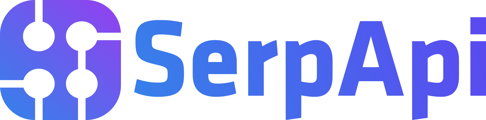
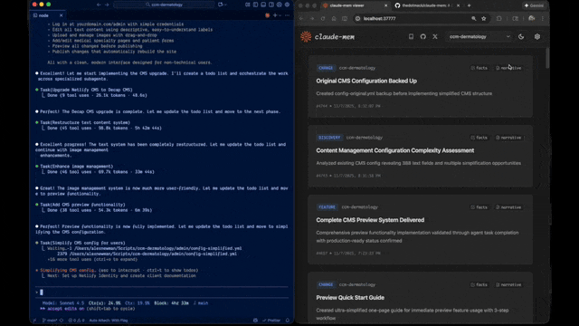

🌐 这是自动翻译。欢迎社区修正!

<h1 align="center">
  <br>
  <a href="https://github.com/thedotmack/claude-mem">
    <picture>
      <source media="(prefers-color-scheme: dark)" srcset="https://raw.githubusercontent.com/thedotmack/claude-mem/main/docs/public/claude-mem-logo-for-dark-mode.webp">
      <source media="(prefers-color-scheme: light)" srcset="https://raw.githubusercontent.com/thedotmack/claude-mem/main/docs/public/claude-mem-logo-for-light-mode.webp">
      
    </picture>
  </a>
</h1>

<p align="center">
  
  &nbsp;&nbsp;&nbsp;
  
  &nbsp;&nbsp;&nbsp;
  
</p>

<p align="center">
  <a href="README.zh.md">🇨🇳 中文</a> •
  <a href="README.zh-tw.md">🇹🇼 繁體中文</a> •
  <a href="README.ja.md">🇯🇵 日本語</a> •
  <a href="README.pt.md">🇵🇹 Português</a> •
  <a href="README.pt-br.md">🇧🇷 Português</a> •
  <a href="README.ko.md">🇰🇷 한국어</a> •
  <a href="README.es.md">🇪🇸 Español</a> •
  <a href="README.de.md">🇩🇪 Deutsch</a> •
  <a href="README.fr.md">🇫🇷 Français</a> •
  <a href="README.he.md">🇮🇱 עברית</a> •
  <a href="README.ar.md">🇸🇦 العربية</a> •
  <a href="README.ru.md">🇷🇺 Русский</a> •
  <a href="README.pl.md">🇵🇱 Polski</a> •
  <a href="README.cs.md">🇨🇿 Čeština</a> •
  <a href="README.nl.md">🇳🇱 Nederlands</a> •
  <a href="README.tr.md">🇹🇷 Türkçe</a> •
  <a href="README.uk.md">🇺🇦 Українська</a> •
  <a href="README.vi.md">🇻🇳 Tiếng Việt</a> •
  <a href="README.tl.md">🇵🇭 Tagalog</a> •
  <a href="README.id.md">🇮🇩 Indonesia</a> •
  <a href="README.th.md">🇹🇭 ไทย</a> •
  <a href="README.hi.md">🇮🇳 हिन्दी</a> •
  <a href="README.bn.md">🇧🇩 বাংলা</a> •
  <a href="README.ur.md">🇵🇰 اردو</a> •
  <a href="README.ro.md">🇷🇴 Română</a> •
  <a href="README.sv.md">🇸🇪 Svenska</a> •
  <a href="README.it.md">🇮🇹 Italiano</a> •
  <a href="README.el.md">🇬🇷 Ελληνικά</a> •
  <a href="README.hu.md">🇭🇺 Magyar</a> •
  <a href="README.fi.md">🇫🇮 Suomi</a> •
  <a href="README.da.md">🇩🇰 Dansk</a> •
  <a href="README.no.md">🇳🇴 Norsk</a>
</p>

<h4 align="center">为 <a href="https://claude.com/claude-code" target="_blank">Claude Code</a> 构建的持久化记忆压缩系统。</h4>

<p align="center">
  <a href="../../LICENSE">
    
  </a>
  <a href="../../package.json">
    
  </a>
  <a href="../../package.json">
    
  </a>
  <a href="https://github.com/thedotmack/awesome-claude-code">
    
  </a>
</p>

<p align="center">
 <a href="https://www.star-history.com/thedotmack/claude-mem">
  <picture><source media="(prefers-color-scheme: dark)" srcset="https://api.star-history.com/badge?repo=thedotmack/claude-mem&type=rank&theme=dark" /><source media="(prefers-color-scheme: light)" srcset="https://api.star-history.com/badge?repo=thedotmack/claude-mem&type=rank" /></picture> <picture><source media="(prefers-color-scheme: dark)" srcset="https://api.star-history.com/badge?repo=thedotmack/claude-mem&type=trending&theme=dark" /><source media="(prefers-color-scheme: light)" srcset="https://api.star-history.com/badge?repo=thedotmack/claude-mem&type=trending" /></picture>
 </a>
</p>

<br>

<table align="center">
  <tr>
    <td align="center">
      <a href="https://github.com/thedotmack/claude-mem">
        <picture>
          
        </picture>
      </a>
    </td>
    <td align="center">
      <a href="https://www.star-history.com/#thedotmack/claude-mem&Date">
        <picture>
          <source
            media="(prefers-color-scheme: dark)"
            srcset="https://api.star-history.com/image?repos=thedotmack/claude-mem&type=date&theme=dark&legend=top-left"
          />
          <source
            media="(prefers-color-scheme: light)"
            srcset="https://api.star-history.com/image?repos=thedotmack/claude-mem&type=date&legend=top-left"
          />
          
        </picture>
      </a>
    </td>
  </tr>
</table>

<p align="center">
  <a href="#快速开始">快速开始</a> •
  <a href="#工作原理">工作原理</a> •
  <a href="#mcp-搜索工具">搜索工具</a> •
  <a href="#文档">文档</a> •
  <a href="#配置">配置</a> •
  <a href="#故障排除">故障排除</a> •
  <a href="#许可证">许可证</a>
</p>

<p align="center">
  Claude-Mem 通过自动捕获工具使用观察、生成语义摘要并使其可用于未来会话,无缝保留跨会话的上下文。这使 Claude 能够在会话结束或重新连接后,依然保持对项目知识的连续性。
</p>

---

## 快速开始

为 Grok Bot 安装 claude-mem:

```bash
npx claude-mem install --ide grok-bot
```

Grok Bot 没有宿主钩子,因此我们改为监控聊天日志文件。默认使用 CMEM Pro(托管记忆)。本地观察器需手动开启:传入 `--provider host`。安装本插件不会安装 Cursor。

**意识推送试点(LFG + Orifice):** 关键观察(`decision`、`bugfix`、`security_alert`、`sensitive` 类型)会以带日期的 `- YYYY-MM-DD [awareness] …` 形式追加到对应机器人的 `memory/log/YYYY-MM.md` 文件中。Grok Bot 本身会从磁盘重新读取该日志。此功能不会写入 `profile.md`、用户记忆或项目记忆。通过 `CLAUDE_MEM_GROK_BOT_AWARENESS_ENABLED=false` 可将其关闭。

使用一条命令即可安装:

```bash
npx claude-mem install
```

安装器会先完成所有设置,然后引导你在浏览器中登录 claude-mem(邮箱魔法链接——无需绑卡)。登录会为你的账户开通记忆密钥,并解锁附带 **30 天免费试用**的 **claude-mem 观察器**:记忆在套餐之外运行,你的套餐用量最多可提升 100%。免费试用结束后,记忆会自动回退到你的 Anthropic 套餐,除非你另行订阅。登录后你可以选择记忆提供商——claude-mem 观察器、你自己的 OpenRouter 或 Gemini 密钥,或你的 Anthropic 套餐。

想跳过登录?传入显式的 `--provider` 标志、设置 `CLAUDE_MEM_ONLINE_OPTIN=false`,或在 CI/非交互 shell 中运行——安装器无需任何账户交互即可完成。

或为 OpenCode 安装:

```bash
npx claude-mem install --ide opencode
```

适用于 OpenCode 1.3.4 及更高版本,包括 OpenCode 2。安装后请重启 OpenCode。

或为 **T3 Code**(Codex 与 Claude Code 提供商)安装:

```bash
npx claude-mem install --ide t3code
```

安装器会发现 T3 Code 已启用的提供商,在其各自的配置目录中注册原生 Claude-Mem 插件,并支持 T3 管理的 Codex。重启 T3 Code,在出现提示时信任该提供商的钩子,然后开启新会话。自定义服务器设置、状态查看与卸载方法请参阅 [T3 Code 集成指南](https://docs.claude-mem.ai/t3code-integration)。

或为 Antigravity CLI 安装([设置指南](https://docs.claude-mem.ai/antigravity-cli/setup)):

```bash
npx claude-mem install --ide antigravity
```

或为 OMP(Oh My Pi)安装:

```bash
npx claude-mem install --ide omp
```

或安装原生 Pi 扩展或 DeepSeek Harness 插件:

```bash
npx claude-mem install --ide pi
npx claude-mem install --ide dsh --dsh-profile tui
```

Pi 与 DeepSeek Harness 使用 worker 运行时。捕获、召回与故障排除请参阅[原生 harness 设置](../native-harness-integrations.md)。

或在 Claude Code 内部从插件市场安装:

```bash
/plugin marketplace add thedotmack/claude-mem

/plugin install claude-mem
```

重启 Claude Code。来自先前会话的上下文将自动出现在新会话中。

> **注意:** Claude-Mem 也已发布到 npm,但 `npm install -g claude-mem` 仅安装 **SDK/库本身** —— 它不会注册插件钩子,也不会设置 worker 服务。请始终通过 `npx claude-mem install` 或上述 `/plugin` 命令进行安装。

### 🦞 OpenClaw Gateway

只需一条命令,即可在 [OpenClaw](https://openclaw.ai) 网关上将 claude-mem 安装为持久化记忆插件:

```bash
curl -fsSL https://install.cmem.ai/openclaw.sh | bash
```

该安装程序会处理依赖项、插件设置、AI 提供商配置、worker 启动,以及可选的向 Telegram、Discord、Slack 等平台的实时观察推送。详情请参阅 [OpenClaw 集成指南](https://docs.claude-mem.ai/openclaw-integration)。

**核心特性:**

- 🧠 **持久化记忆** - 上下文跨会话保留
- 📊 **渐进式披露** - 分层记忆检索,具有令牌成本可见性
- 🔍 **智能搜索(默认)** - 使用三步 mem-search 技能查询项目历史
- 🖥️ **本地 My Work** - 在启动时打印的 worker URL 上查看实时请求、进度、人工交接与已保存的复核队列,详见[指南](https://docs.claude-mem.ai/usage/my-work)。记忆、会话与设置仍位于 `/viewer`。
- 👥 **TeamBrain** - My Work 旁的可选共享工作区,提供真实的团队工作清单、成员归属和关联发现。每个人自行选择分享内容;个人请求与复核笔记保持独立。[组建团队](https://cmem.ai/teambrain/start)。
- 💻 **Claude Desktop 技能** - 从 Claude Desktop 对话中搜索记忆
- 🔒 **隐私控制** - 使用 `<private>` 标签排除敏感内容的存储
- 🖼️ **截图(可选,默认关闭)** - 将工具截图的转换副本保存在 `~/.claude-mem/media-v1/`,仅在开启 Cloud Sync 时上传到 cmem.ai,仅在单独启用图像推理时发送给观察模型([详情](https://docs.claude-mem.ai/configuration#screenshots-and-images-opt-in))
- ⚙️ **上下文配置** - 精细控制注入的上下文内容
- 🤖 **自动操作** - 无需手动干预
- 🔗 **引用** - 通过 worker API 使用 ID 引用过去的观察,或在 Web 查看器中查看全部

---

## 文档

📚 **[查看完整文档](https://docs.claude-mem.ai/)** - 在官方网站浏览

### 入门指南

- **[安装指南](https://docs.claude-mem.ai/installation)** - 快速开始与高级安装
- **[使用指南](https://docs.claude-mem.ai/usage/getting-started)** - Claude-Mem 如何自动工作
- **[搜索工具](https://docs.claude-mem.ai/usage/search-tools)** - 使用自然语言查询项目历史
- **[Cloud Sync](https://docs.claude-mem.ai/cloud-sync)** - 将你的记忆备份到 cmem.ai——无需守护进程,worker 会在写入时同步

### 最佳实践

- **[上下文工程](https://docs.claude-mem.ai/context-engineering)** - AI 代理上下文优化原则
- **[渐进式披露](https://docs.claude-mem.ai/progressive-disclosure)** - Claude-Mem 上下文启动策略背后的哲学

### 架构

- **[概述](https://docs.claude-mem.ai/architecture/overview)** - 系统组件与数据流
- **[架构演进](https://docs.claude-mem.ai/architecture-evolution)** - 从 v3 到 v5 的旅程
- **[钩子架构](https://docs.claude-mem.ai/hooks-architecture)** - Claude-Mem 如何使用生命周期钩子
- **[钩子参考](https://docs.claude-mem.ai/architecture/hooks)** - 逐条讲解每个钩子
- **[Worker 服务](https://docs.claude-mem.ai/architecture/worker-service)** - HTTP API 与 Bun 管理
- **[数据库](https://docs.claude-mem.ai/architecture/database)** - SQLite 模式与 FTS5 搜索
- **[搜索架构](https://docs.claude-mem.ai/architecture/search-architecture)** - 使用 Chroma 向量数据库的混合搜索

### 配置与开发

- **[配置](https://docs.claude-mem.ai/configuration)** - 环境变量与设置
- **[开发](https://docs.claude-mem.ai/development)** - 构建、测试、贡献
- **[故障排除](https://docs.claude-mem.ai/troubleshooting)** - 常见问题与解决方案

---

## 工作原理

**核心组件:**

1. **生命周期钩子** - SessionStart、UserPromptSubmit、PreToolUse、PostToolUse、Stop、SessionEnd。每个钩子都是一条无 shell 命令 `claude-mem hook claude-code <event>`,由安装器放入 PATH 的小型启动器运行
2. **智能安装** - 带缓存的依赖检查器(`claude --init` / `--maintenance` 时的 Setup 钩子,以及 `npx claude-mem install` / `repair`)
3. **Worker 服务** - 本地 HTTP API,带有 Web 查看器界面和搜索端点,由 Bun 管理
4. **SQLite 数据库** - 存储会话、观察、摘要
5. **mem-search 技能** - 具有渐进式披露的自然语言查询
6. **Chroma 向量数据库** - 混合语义 + 关键词搜索,实现智能上下文检索

详见[架构概述](https://docs.claude-mem.ai/architecture/overview)。

---

## MCP 搜索工具

Claude-Mem 通过 **4 个 MCP 工具**提供智能记忆搜索,遵循一种省令牌的**三层工作流模式**:

**三层工作流:**

1. **`search`** - 获取带有 ID 的紧凑索引(约 50-100 个令牌/结果)
2. **`timeline`** - 获取感兴趣结果周围的时间顺序上下文
3. **`get_observations`** - 仅为筛选出的 ID 获取完整详情(约 500-1,000 个令牌/结果)

**工作方式:**
- Claude 使用 MCP 工具搜索您的记忆
- 首先使用 `search` 获取结果索引
- 使用 `timeline` 查看特定观察周围发生的情况
- 使用 `get_observations` 为相关 ID 获取完整详情
- 通过在获取详情前进行筛选,**节省约 10 倍的令牌**

**可用的 MCP 工具:**

1. **`search`** - 使用全文查询搜索记忆索引,按类型/日期/项目筛选
2. **`timeline`** - 获取特定观察或查询周围的时间顺序上下文
3. **`get_observations`** - 按 ID 获取完整观察详情(始终批量处理多个 ID)

**使用示例:**

```typescript
// 步骤 1:搜索索引
search(query="authentication bug", type="bugfix", limit=10)

// 步骤 2:查看索引,识别相关 ID(例如 #123、#456)

// 步骤 3:获取完整详情
get_observations(ids=[123, 456])
```

详见[搜索工具指南](https://docs.claude-mem.ai/usage/search-tools)的详细示例。

---

## 系统要求

- **Node.js**: 20.0.0 或更高版本
- **Claude Code**: 支持插件的最新版本
- **Bun**: JavaScript 运行时和进程管理器(如缺失会自动安装)
- **uv**: 用于向量搜索的 Python 包管理器(如缺失会自动安装)
- **SQLite 3**: 用于持久化存储(已内置)

---
### Windows 设置说明

如果您看到类似以下的错误:

```powershell
npm : The term 'npm' is not recognized as the name of a cmdlet
```

请确保 Node.js 和 npm 已安装并已添加到您的 PATH 中。请从 https://nodejs.org 下载最新的 Node.js 安装程序,并在安装后重启终端。

Claude Code 钩子不需要 Git Bash。每个钩子都直接运行 `claude-mem`,而 `npx claude-mem install` 会将该启动器放在 `%LOCALAPPDATA%\claude-mem\bin\claude-mem.exe` 并把该目录加入用户 Path。之后请重启终端或 IDE,让 Claude Code 识别新的 Path。如果钩子报告 `Executable not found in $PATH: "claude-mem"`,请运行 `npx claude-mem doctor` 并参阅[故障排除](https://docs.claude-mem.ai/troubleshooting#claude-mem-command-not-found-in-hooks)。

---

## 配置

设置在 `~/.claude-mem/settings.json` 中管理(首次运行时自动创建默认设置)。可配置 AI 模型、worker 端口、数据目录、日志级别和上下文注入设置。

要在 Claude Code 与 Codex 的 SessionStart 上下文中纳入来自所有 harness 的观察,可在该文件中设置 `"CLAUDE_MEM_SESSION_START_INCLUDE_ALL_SOURCES": "true"`,或在查看器设置中启用 **Include all sources at session start**。默认值为 `"false"`,即启动上下文仅限当前 harness。所选来源仍受观察数量上限约束。

详见 **[配置指南](https://docs.claude-mem.ai/configuration)** 了解所有可用设置和示例。

### 模式与语言配置

Claude-Mem 通过 `CLAUDE_MEM_MODE` 设置支持多种工作流模式和语言。

此选项同时控制:
- 工作流行为(例如 code、chill、investigation)
- 生成观察时所使用的语言

#### 配置方法

编辑位于 `~/.claude-mem/settings.json` 的设置文件:

```json
{
  "CLAUDE_MEM_MODE": "code--zh"
}
```

模式定义在 `plugin/modes/` 中。要在本地查看所有可用模式:

```bash
ls ~/.claude/plugins/marketplaces/thedotmack/plugin/modes/
```

#### 可用模式

| 模式 | 描述 |
|------------|-------------------------|
| `code` | 默认英文模式 |
| `code--chill` | 记录更少的观察,只保留日后重新发现会很费力的内容 |
| `code--[lang]` | 与 `code` 相同,但观察和摘要用另一种语言撰写 |

内置语言代码:`ar`, `bn`, `cs`, `da`, `de`, `el`, `es`, `fi`, `fr`, `he`, `hi`, `hu`, `id`, `it`, `ja`, `ko`, `nl`, `no`, `pl`, `pt-br`, `ro`, `ru`, `sv`, `th`, `tr`, `uk`, `ur`, `vi`, `zh`。例如,`code--ko` 会用韩语写入记忆。

各语言的名称、电子邮件调查模式和自定义模式,请参阅[模式文档](https://docs.claude-mem.ai/modes)。

> 注意:以上模式均已内置,无需额外安装或更新插件。

#### 更改模式后

重启 Claude Code 以应用新的模式配置。

---

## 开发

详见 **[开发指南](https://docs.claude-mem.ai/development)** 了解构建说明、测试和贡献工作流程。

---

## 故障排除

如果遇到问题,向 Claude 描述问题,troubleshoot 技能将自动诊断并提供修复方案。

详见 **[故障排除指南](https://docs.claude-mem.ai/troubleshooting)** 了解常见问题和解决方案。

---

## Bug 报告

使用自动生成器创建全面的 bug 报告:

```bash
cd ~/.claude/plugins/marketplaces/thedotmack
npm run bug-report
```

## 贡献

欢迎贡献!请:

1. Fork 仓库
2. 创建功能分支
3. 进行更改并添加测试
4. 更新文档
5. 提交 Pull Request(目标分支为 `main`)

发布版本从 `main` 分支构建,并发布到 npm。

详见[开发指南](https://docs.claude-mem.ai/development)了解贡献工作流程。

---

## 许可证

Claude-Mem 根据 Apache License 2.0 授权。

我们选择 Apache-2.0 是因为持久化的代理记忆应该易于嵌入到
开发者工具、本地代理、MCP 服务器、企业系统、机器人技术栈,
以及生产环境的代理运行框架中。

完整详情请参阅 [LICENSE](../../LICENSE) 文件。授权范围及开源/商业边界
请参阅 [docs/license.md](../license.md) 和 [docs/ip-boundary.md](../ip-boundary.md)。


---

## 支持

- **文档**: [docs/](../)
- **问题反馈**: [GitHub Issues](https://github.com/thedotmack/claude-mem/issues)
- **仓库**: [github.com/thedotmack/claude-mem](https://github.com/thedotmack/claude-mem)
- **官方 X 账号**: [@Claude_Memory](https://x.com/Claude_Memory)
- **官方 Discord**: [加入 Discord](https://discord.com/invite/J4wttp9vDu)
- **作者**: Alex Newman ([@thedotmack](https://github.com/thedotmack))

---

**使用 Claude Agent SDK 构建** | **兼容 Claude Code** | **使用 TypeScript 制作**

---

### CMEM 是什么?

CMEM 是由第三方创建、但获得 Claude-Mem 创建者(Alex Newman,@thedotmack)正式认可的代币。该代币是社区增长的催化剂,也是把 CMEM 带给最需要它的开发者与知识工作者的载体。

官方 BASE 合约地址:0x76b1967eec0ccaeb001bbbb2b40dc4badba31ba3
